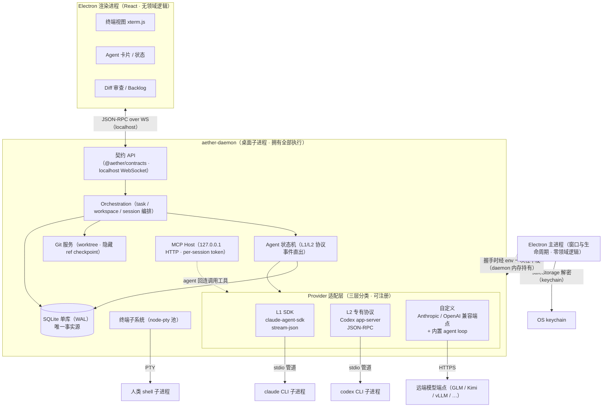
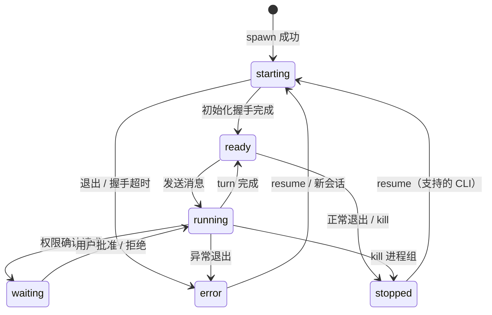

# Aether 架构文档

> 状态：草案 v0.1（2026-11-15）· 决策依据：用户拍板（2026-11-15）+ AgentsRoom 复刻调研
> 引用键：`调研 02/04/05/06/README` 指 `docs/research/agentsroom/` 下对应文件；`用户决策` 指 2026-11-15 拍板记录。

**定位**：Aether 是开源的 Electron 桌面应用——多项目 × 多 agent 编排驾驶舱（复刻 AgentsRoom 思想的开源版，见调研 README）。**纯本地**：无账号、无云端、无 relay、无手机端。

**已定基线**（本文展开）：Electron + TypeScript；daemon 分离（T3 式）；provider = Claude（SDK stream-json）+ Codex（app-server JSON-RPC）+ 自定义可注册；终端 xterm.js + node-pty（升级路径 headless 仿真）；SQLite 单库 WAL；L1/L2 协议事件直出状态机；MCP host P1 起步；TDD 80%；开源（许可证 ADR-007）。

---

## 1. 总体架构



分层职责（调研 06 §1 骨架，T3 式 Environment 所有权模型见调研 05.B）：

| 层                  | 职责                                                   | 禁止事项                              |
| ------------------- | ------------------------------------------------------ | ------------------------------------- |
| 渲染进程            | UI 投影：终端/agent 卡片/diff/backlog                  | 任何领域逻辑、直接 fs/进程访问        |
| Electron 主进程     | 窗口、app 生命周期、spawn 并监护 daemon                | 领域逻辑（零容忍）                    |
| daemon              | 全部执行：agent 进程、PTY、Git、文件、SQLite、MCP host | 不依赖 Electron API（保持可无头复用） |
| `@aether/contracts` | RPC 类型契约，唯一边界                                 | 手写重复类型                          |

接口统一为 `AgentAdapter`（形状参考 T3 packages/contracts + VK executor trait，调研 05.B/05.C）：方法 `spawn / spawnFollowUp / resume / cancel / dispose / normalizeLogs（raw 行数组 → ProviderEvent[]，原样落库后旁路归一化）/ discover（连通性与模型列表探测，自定义 provider P1 验收通道）/ resolvePermission（解除 waiting；UI 侧经 contracts `agents.permission.respond`）`；`AdapterContext.loadEvents(sessionId)` 供自定义 provider resume 时重水化历史。

**权威形状见 SYSTEM_DESIGN §6.2，本文不复述代码签名**（避免第二真相源）。kind = `"claude-sdk" | "codex-app-server" | "custom"`（`"acp" | "tui"` 为 P2+ 预留枚举位）；自定义协议枚举 = `"anthropic" | "openai-chat" | "openai-responses"`；`agentLoop` 取值 `"builtin"`。

---

## 2. 进程模型

### 2.1 进程清单

| 进程 / 实体                | 数量 | 父进程                     | 职责                                                                                |
| -------------------------- | ---- | -------------------------- | ----------------------------------------------------------------------------------- |
| Electron 主进程            | 1    | OS                         | 窗口/生命周期；spawn + 监护 daemon                                                  |
| 渲染进程                   | 1+   | 主进程                     | React UI；经 localhost WS 直连 daemon                                               |
| aether-daemon              | 1    | 主进程（子进程）           | 全部执行与 SQLite；结构化 agent 走 stdio 管道不占 PTY（T3/VK 共识，调研 05.B/05.C） |
| agent CLI 子进程           | 0..N | daemon                     | claude / codex，stdio JSON                                                          |
| 人类 shell PTY 子进程      | 0..N | daemon                     | node-pty；仅人类交互终端                                                            |
| 自定义 provider agent loop | 0..N | —（daemon 内协程）         | 调 Anthropic/OpenAI 兼容端点，无独立进程                                            |
| MCP host                   | 1    | —（daemon 内 HTTP server） | 127.0.0.1 + per-session token                                                       |

### 2.2 生命周期

**启动**：主进程 → spawn daemon（stdout 握手：协议版本 + 随机端口/token）→ daemon 打开 SQLite（WAL）→ 跑 `cleanup_orphan_workspaces()`（VK 做法，调研 05.C）→ 恢复 session 投影 → 渲染进程连 WS 拉全量快照。

**运行**：daemon 是唯一事实源持有者；渲染进程只是投影 + 增量订阅（VK "DB 写钩子 → 合并流"思想，调研 05.C.4）。

**退出**：主进程 `before-quit` → 通知 daemon drain（拒绝新 RPC → 杀 agent 进程组[grace 后强杀] → 关 PTY → `wal_checkpoint`）→ daemon 退出；daemon 无响应则整树强杀。

**孤儿防护**：Windows 用 Job 对象 `kill-on-close`（主进程死 → daemon 随之终止）；POSIX 侧 daemon 监测父进程 PID 变化自杀。学 Orca "宿主死连带杀 agent" 的 spawn 钩子思路（PID 级退出证明，调研 05.A）。kill-on-close 为 P0 设计语义：产品保证的是**会话恢复**而非进程存活（ADR-002）；detached daemon 为 ADR-002 的 P3+ 扩展位。

### 2.3 崩溃恢复

> 恢复口径（ADR-002）：产品保证的是**会话恢复**而非进程存活——渲染层崩溃无感存活；主进程崩溃/升级重启后 daemon 自动重启、从 SQLite 恢复全部状态、Claude/Codex 会话经 CLI 自带 `--resume` 续聊。detached daemon（进程级存活）为 P3+ 扩展位。

| 故障              | 影响                          | 恢复策略                                                                                                                                                                 |
| ----------------- | ----------------------------- | ------------------------------------------------------------------------------------------------------------------------------------------------------------------------ |
| 渲染进程崩溃/刷新 | daemon 无感                   | Electron reload → 重连 WS → 拉快照续增量                                                                                                                                 |
| daemon 崩溃       | agent 子进程随 Job/进程组终止 | 主进程 exit 事件 → 重启 daemon → SQLite 投影恢复 → 内存中 session 收敛为 `error` → 用户可 `--resume <session_id>` 续聊（VK 做法，调研 05.C；仅部分 CLI 真支持，见 §4.2） |
| agent 子进程崩溃  | 该 session                    | 状态机 → `error`；日志已实时落库；重试 = resume 或新会话                                                                                                                 |
| 主进程被杀        | daemon 成孤儿                 | 孤儿防护自杀（§2.2）；数据已落 SQLite，无损                                                                                                                              |
| MCP host 故障     | agent 工具调用失败            | daemon 内组件，随 daemon 重启恢复                                                                                                                                        |

### 2.4 Windows 注意点（重点风险，引调研 05.A / 05.C / 06 §9）

1. **ConPTY 预热**：首次 PTY 创建有可感知延迟，Orca 专门做了预热（调研 05.A、06 §9）；daemon 启动时预热 PTY 池（数量 TBD，见 §6）。
2. **`.cmd` 引号**：spawn `.cmd/.bat`（npx 安装的 CLI 常见）需正确引号转义，Orca 的 SDK 适配专门处理过（调研 05.A、06 §9）；统一封装 spawn 工具函数 + 用例覆盖。
3. **进程树击杀**：Windows Job 对象整树杀；POSIX 进程组 `kill`；孤儿（如 agent 拉起的 MCP server）等 grace 后再强杀（VK：5s，调研 05.C）。
4. **隐藏控制台窗口**：spawn 一律 `windowsHide`，避免闪黑框（VK `kill_on_drop` + 隐藏窗口，调研 05.C）。
5. 以上全部收敛到独立包 `packages/process-host`（学 Orca `@orca/process-host` 的 spawn/树杀/退出证明，MIT，调研 05.A、06 §8）；monorepo 包结构对齐权威清单：`process-host` 为独立包、不设独立 shared 包、共享工具收敛于 `packages/core`（最终形态见 SYSTEM_DESIGN §2）。
6. **路径长度**：worktree 根目录 = 项目同级 `.aether-worktrees/`（repo 外、不弄脏主 checkout、避开 userData 深路径）；不可写时回退 `userData/aether/worktrees/<id>`。daemon 调 git 统一带 `-c core.longpaths=true`；`storage_key`/`name` 生成避开 Windows 保留设备名（CON/PRN/AUX/COM1…）并做大小写折叠（casefold）校验。

---

## 3. 架构决策记录（ADR）

> 本文件为 ADR 唯一登记处，编号 001-007；其余文档（SYSTEM_DESIGN / TECH_STACK / PRD / TASK_LIST）引用 ADR 时以本系列为准，不另行登记。

### ADR-001 · Electron + TypeScript

- **背景**：需要桌面 IDE 形态；框架候选 Electron vs Tauri，语言候选 TS vs Rust（调研 06 §0）。
- **决策**：Electron + TypeScript 全栈，pnpm monorepo。
- **理由**：4/6 头部项目选 Electron；node-pty / xterm / claude-agent-sdk / MCP SDK 生态全在 JS；Tauri 的 Windows 成熟度有 Jean 前车之鉴（调研 06 §0）。
- **后果（正）**：单一语言降低边界成本；`@anthropic-ai/claude-agent-sdk`、ACP、MCP 均为 TS 一等公民（调研 06 §0）。
- **后果（负）**：安装包与内存开销大——接受，不构成 MVP 决定性劣势。

### ADR-002 · daemon 分离（T3 式）

- **背景**：Orca / T3 / Happy / Paseo / Herdr 全部收敛"执行权归 daemon，UI 只是客户端"（调研 README 公理 2）。
- **决策**：Electron 主进程零领域逻辑；aether-daemon 作为桌面子进程拥有 agent 进程 / PTY / Git / 文件 / SQLite / MCP host；类型化契约包 `@aether/contracts` 为唯一边界（T3 `packages/contracts` 模式 + DesktopBackendManager 拉起方式，调研 05.B、06 §1、06 §8）。P0 采用 kill-on-close：daemon 是主进程子进程、随 Job 结束（§2.2）。
- **后果（正）**：产品保证的是**会话恢复**而非进程存活——渲染层崩溃无感存活；主进程崩溃/升级重启后 daemon 自动重启、从 SQLite 恢复全部状态、Claude/Codex 会话经 CLI 自带 `--resume` 续聊。同一 daemon 未来可无头复用（CLI / CI）；daemon 可脱离 Electron 直接做集成测试（TDD 红利）。
- **扩展位（P3+）**：detached daemon（进程级存活）——届时桌面壳崩溃/升级不再连带 daemon；属本 ADR 的显式演进方向，非 P0 语义。
- **后果（负）**：进程通信与契约版本兼容成本；双进程调试复杂度。
- **边界**：MVP 终端并入 daemon；Orca 式独立终端 daemon（orcad）留作可靠性阶段（调研 06 §1）。

### ADR-003 · Provider 三层分类 + 自定义注册

- **背景**：Orca 证明 agent 接入应按三层设计接口（TUI-in-PTY / 厂商结构化协议 / SDK，调研 05.A.3）；用户拍板 MVP 只做 Claude + Codex + 自定义。
- **决策**：Adapter 接口保留三层分类法全部接口位——L1 SDK（claude-agent-sdk，stream-json）、L2 专有协议（Codex app-server，JSON-RPC over stdio）、**自定义 provider**（任意 Anthropic / OpenAI 兼容端点 + daemon 内轻量 agent loop，参考 happy-providers 的 anthropic / chatCompletions / responses 三协议形态，用户决策）；ACP 与 TUI-in-PTY 为 P2+ 扩展位。
- **后果（正）**：用户可接 GLM / Kimi / 本地 vLLM 等任意兼容端点；新增协议 = 新增 adapter 包零侵入（T3 Driver/Instance 分层经验，调研 05.B.4）。
- **后果（负）**：内置 loop 能力上限低于真 CLI（无原生 hooks / subagent 生态），UI 必须标注能力差异（借鉴 AgentsRoom 对会话恢复差异的诚实标注，调研 06 §9.2）。
- **接口形状**：抄 VK executor trait 思路（spawn / spawnFollowUp / resume / cancel / dispose / normalizeLogs / discover + resolvePermission；统一命名与权威形状见 SYSTEM_DESIGN §6.2，调研 05.C）。

### ADR-004 · 终端选型：xterm.js + node-pty，升级路径 headless 仿真

- **背景**：调研 06 §3 给出三阶段演进：xterm+node-pty → headless 仿真快照（Orca）→ Ghostty replica（Happy，天花板）。
- **决策**：MVP 用 xterm.js 渲染 + node-pty（PTY 归 daemon）；结构化 agent（L1/L2/自定义）走 stdio/HTTP **不占 PTY**（T3/VK 共识"结构化管道优先"，调研 05.B/05.C），PTY 只给人类 shell（未来 TUI-in-PTY 再扩展）；升级路径：daemon 内 `@xterm/headless` 权威仿真 + SerializeAddon 快照，多客户端 attach 拿快照+增量（Orca 式，调研 05.A.2）。
- **P0 过渡定义**：agent 活动视图 = 结构化事件流渲染（assistant 消息 / 工具调用）+ 跟问输入框 + permission_request 批准弹层——"每 agent 一个活动 pane（事件流）"，"在 worktree 打开人类终端"；TUI-in-PTY（agent 直接占终端）为 P2+ 扩展位。
- **后果（正）**：MVP 实现最简；升级路径已被 Orca 验证。
- **后果（负）**：多客户端共看同一终端、Chat↔Terminal 无损互切须等 headless 阶段。

### ADR-005 · SQLite 单库

- **背景**：四个深挖仓库全部 SQLite + WAL（Orca node:sqlite / T3 node:sqlite / VK sqlx / Happy libsql，调研 05.A–D）。
- **决策**：SQLite 单库为唯一事实源，WAL；驱动已定 `node:sqlite`（P0-01 内 spike 验证 `ELECTRON_RUN_AS_NODE` 模式可用；唯一回退条件 = spike 失败 → `better-sqlite3`，见 §6-1）。数据模型主干抄 VK 五层：`project → task → workspace(git worktree) → session → execution_process(+logs)`（调研 05.C）；P2 增加 Orca 编排表（run / worker_dispatch / mailbox，调研 05.A.5）。日志 JSONL **原样落库 + per-vendor `normalize_logs` 旁路**（vendor 格式变化只改一个文件，调研 05.C.5）；checkpoint 用隐藏 git ref（调研 05.B）。MVP 不做事件溯源，用"SQLite 投影 + outbox"简化（调研 06 §4）。
- **后果（正）**：零部署、单文件备份、事务一致性。
- **后果（负）**：单写者约束；高频日志写入需批量合并。

### ADR-006 · 纯本地，无账号无云端

- **背景**：用户拍板；调研 README 差异化机会 1（开源 + 本地优先）与 06 §11.3（是否做账号/云决定 relay 与 mobile 优先级）。
- **决策**：无账号体系、无云端、无 E2E relay、无手机端；一切数据本地存储。数据目录约定：Electron `userData` 下 `aether/`，可用 `AETHER_DATA_DIR` 迁移（借鉴 AgentsRoom 的 `AGENTSROOM_DATA_DIR`，调研 02 §c）；细目 TBD（见 §6）。
- **后果（正）**：无服务器成本、无隐私争议；备份 = 复制库文件（先 `wal_checkpoint`）。
- **后果（放弃项，明确接受）**：放弃 relay / 手机遥控 / 多机 Fleet / 跨机接续（AgentsRoom 公理 7 的全部远程场景，调研 README）；跨设备同步无限期不做；daemon 恒与桌面同机，SSH remote host 后议。06 §7 的 P4 阶段取消。

### ADR-007 · 开源许可证

- **背景**：用户拍板开源；调研 06 §9.4 上游死亡教训（选 Apache/MIT 依赖、准备接盘）；竞品格局 MIT（Orca/T3/Happy）与 Apache-2.0（VK/Paseo）并存（调研 README 表）。
- **决策**：MIT（2026-11-15 项目所有者确认；LICENSE 已落仓库根）。
- **理由**：拟复用件几乎全为 MIT——electron-mcp-server、T3 契约模式、Orca process-host 思路（调研 06 §8）；VK 代码（Apache-2.0）向 MIT 项目搬运合规，保留版权声明即可。
- **后果**：贡献流程 / CLA（可不设）/ 仓库公开时点 TBD；若未来需专利保护伞，改 Apache-2.0 越早越好。

---

## 4. 关键机制设计

### 4.1 worktree 生命周期（持久预留先行）

核心规则抄 Happy：**先写 SQLite 行（唯一 name / storage_key / branch），再动 Git**——并发碰撞安全、崩溃可恢复（调研 05.D）。并发控制与孤儿清理抄 VK：按路径全局锁防并发创建、启动跑 `cleanup_orphan_workspaces()`（调研 05.C）。

```typescript
// 枚举唯一来源：@aether/contracts 的 WorkspaceStatus（七值全集）；
// 本文与 SYSTEM_DESIGN §4.2（DDL CHECK）均引用此全集，不另行复述。
type WorkspaceStatus =
  | "reserved" // 行已落库，Git 未动（持久预留先行）
  | "creating" // git worktree add 进行中
  | "ready" // 可绑定 session
  | "archived" // 逻辑归档，文件仍在
  | "deleting" // 清理中
  | "failed" // 创建/删除失败，行保留供诊断
  | "orphaned"; // 行与文件系统/拥有者失联（如 daemon 崩溃残留），待对账收敛

interface Workspace {
  readonly id: WorkspaceId;
  readonly projectId: ProjectId;
  readonly name: string; // 全局唯一（唯一索引）
  readonly branch: string; // worktree 专属分支
  readonly storageKey: string; // 存储目录名，全局唯一
  readonly status: WorkspaceStatus;
  readonly createdAt: string;
}
```

时序规则：

1. **预留**：单事务 INSERT（name / storage_key / branch 唯一约束）→ `reserved`。
2. **创建**：全局路径锁内 `git worktree add` → `ready`；失败 → `failed`（行保留供诊断）。
3. **使用**：session 绑定 workspace；checkpoint 写隐藏 ref（`refs/aether/…`，不产生用户可见 commit，T3 做法，调研 05.B）。
4. **清理**：先杀 workspace 关联进程组（grace 后强杀）→ `git worktree remove` → 删行。
5. **崩溃恢复**：daemon 启动扫描 `creating`/`deleting`/`orphaned`——`creating` 超时 → `failed`（行保留供诊断）；`deleting` 未完成 → 重跑删除；`orphaned` → 对账后收敛为 `ready`/`archived`/`deleting`（VK 生命周期范本，调研 05.C）。

### 4.2 agent 状态机（T3 式，协议事件直出）

六态抄 T3 ProviderAdapter（调研 05.B）。L1/L2/自定义 loop 均有结构化事件，状态直接来自协议；**MVP 不做终端流解析**（用户决策）——AgentsRoom 的三通道推断（终端流解析 + CLI hooks + MCP 自报，调研 02 §b）是 P2+ TUI 层才需要的手段。

```typescript
type AgentSessionStatus =
  | "starting" // 已 spawn，握手/初始化中
  | "ready" // 协议就绪，等待消息
  | "running" // turn 进行中
  | "waiting" // 等待用户输入 / 权限确认
  | "stopped" // 正常退出
  | "error"; // 异常退出 / 协议错误 / 超时
```



补充规则：

- `waiting` 判定依赖协议事件（Claude SDK 权限请求、Codex approval、自定义 loop 自产同形事件）。
- daemon 重启后内存态 session 收敛为 `stopped/error`（进程已死），谱系与日志在 SQLite；仅部分 CLI 真正支持 resume（调研 02 §a / 06 §9.2）——Claude、Codex 在支持列表，其余降级为"新会话 + 喂 transcript"并**在 UI 标注差异**（AgentsRoom 的诚实做法，调研 02 §a）。
- UI 四态（Working / Done / Needs input / Idle）是六态的投影（分层借鉴 AgentsRoom UI/底层枚举分离，调研 02 §b）；本地状态 API 采用轮询范本（turn 级 1 秒粒度，调研 02 §b）。

### 4.3 MCP host 安全模型

模型抄 AgentsRoom Shared 模式（调研 02 §d）：全机一个 host 进程（daemon 内）+ **每 console session 独立 token**。

- **绑定**：HTTP server 只绑 `127.0.0.1`，随机端口。
- **注入**：按各 CLI 配置格式写入（Claude `.mcp.json`、Codex 的 `CODEX_HOME`，调研 02 §d）。
- **鉴权**：Bearer token；每 agent console 独立发放，撤销 = 删行；token ≥128bit 随机。
- **额外防护**（自设计，非调研结论）：校验 `Host` 头为 `127.0.0.1` 防 DNS rebinding；日志与契约消息永不携带 token。
- **读写礼仪**（抄 AgentsRoom，调研 02 §d）：读免确认；写需明确请求；删除必须点名；**agent 不能改自己配置 / 关自己**。
- **工具家族分期**（用户决策）：P1 = backlog + terminal + memory；P2 = browser QA（复用 AgentsRoom 自家 `electron-mcp-server`，MIT、CDP、17 个现成工具，调研 02 §i）+ mail + delegation。
- **token 存放（已定）**：本地数据目录文件 + 严格文件权限（AgentsRoom 形态，调研 02 §c）；轮换 = 删行重发。

### 4.4 secret 处理

> 注：任务书要求"OS keychain，引调研 02 §i"，但 02 §i 实际内容为 Electron 分发链（electron-mcp-server），**不涉及 keychain**。按写作规则不编造，此处引用调研中真实存在的依据；keychain 选型已定 Electron `safeStorage`（见下）。

实际依据：T3 将凭据归 Environment 所有并独立为 `secret-provider-*` 包（调研 05.B）；AgentsRoom 的 mcp-host 令牌等存本地数据目录 `~/.agentsroom/`（调研 02 §c）；Happy 将凭证以环境变量注入 agent 子进程（`ANTHROPIC_API_KEY` / `CLAUDE_CODE_OAUTH_TOKEN` 等，调研 05.D）。

设计：

- **原则**：secret 永不明文进 SQLite、永不进日志、永不进契约消息；SQLite 只存引用句柄。
- **存储**：OS keychain（Electron `safeStorage`）；SQLite 只存 `SecretRef` 引用，密文也不入库。
- **解密时序**（三步）：① 主进程经 Electron `safeStorage` 解密 → ② daemon 启动握手时经环境变量一次性下发 → ③ daemon 内存持有（daemon 重启由主进程重发）；daemon 不依赖任何 Electron API、不新增原生模块。
- **注入**：spawn agent 时经 env 注入（Happy 做法，调研 05.D）；自定义 provider 的 API key 同路径。
- **MCP token**：本地数据目录文件 + 严格文件权限（AgentsRoom 形态，调研 02 §c）。

```typescript
interface SecretRef {
  readonly id: string; // keychain 条目句柄，非明文
  readonly kind: "apiKey" | "mcpToken" | "gitCredential";
  readonly providerId: string;
}
```

---

## 5. 组件 × 调研参考映射表

| Aether 组件                           | 抄谁                                                                                                                                 | 出处                                           |
| ------------------------------------- | ------------------------------------------------------------------------------------------------------------------------------------ | ---------------------------------------------- |
| daemon 分离 / 主进程零领域逻辑        | T3（Environment 所有权 + DesktopBackendManager）                                                                                     | 调研 05.B、06 §1                               |
| 类型化契约包 `@aether/contracts`      | T3 `packages/contracts`                                                                                                              | 调研 05.B、06 §8                               |
| Provider adapter 接口形状             | VK executor trait（Aether 统一命名 spawn/spawnFollowUp/resume/cancel/dispose/normalizeLogs/discover，权威形状见 SYSTEM_DESIGN §6.2） | 调研 05.C                                      |
| 三层分类法（接口位保留）              | Orca（TUI / ACP / SDK）                                                                                                              | 调研 05.A.3                                    |
| L1 Claude 接入                        | `@anthropic-ai/claude-agent-sdk`（Orca/T3/Happy 同款）                                                                               | 调研 05.A–D                                    |
| L2 Codex 接入                         | T3 `effect-codex-app-server` / VK codex 适配器                                                                                       | 调研 05.B/05.C                                 |
| 自定义 provider 三协议形态            | happy-providers（anthropic / chatCompletions / responses）                                                                           | 用户决策（调研 05.D 背书其 provider 分包结构） |
| agent 六态状态机                      | T3 ProviderAdapter                                                                                                                   | 调研 05.B                                      |
| 数据模型五层                          | VK project→task→workspace→session→execution_process(+logs)                                                                           | 调研 05.C                                      |
| mailbox / run / dispatch 编排表（P2） | Orca"编排即数据"                                                                                                                     | 调研 05.A.5                                    |
| worktree 持久预留先行                 | Happy Workspace（先写行再动 Git）                                                                                                    | 调研 05.D                                      |
| worktree 全局锁 + 孤儿清理            | VK ContainerService                                                                                                                  | 调研 05.C                                      |
| 隐藏 ref checkpoint                   | T3                                                                                                                                   | 调研 05.B                                      |
| 日志原样落库 + 归一化旁路             | VK `normalize_logs`                                                                                                                  | 调研 05.C                                      |
| 终端 MVP（xterm.js + node-pty）       | Jean/VK 形态                                                                                                                         | 调研 06 §3                                     |
| headless 终端升级路径                 | Orca `@xterm/headless` + SerializeAddon                                                                                              | 调研 05.A.2                                    |
| 终端同步天花板（远期）                | Happy Ghostty replica 协议                                                                                                           | 调研 05.D                                      |
| 进程树治理 `process-host`             | Orca `@orca/process-host` + VK 进程组/grace kill                                                                                     | 调研 05.A/05.C                                 |
| MCP host（127.0.0.1 + token + 礼仪）  | AgentsRoom Shared 模式                                                                                                               | 调研 02 §d                                     |
| MCP browser QA（P2 复用）             | AgentsRoom `electron-mcp-server`（MIT）                                                                                              | 调研 02 §i                                     |
| 本地状态 API 轮询范本                 | AgentsRoom local-status-api                                                                                                          | 调研 02 §b                                     |
| secret 独立 provider 包               | T3 `secret-provider-*`                                                                                                               | 调研 05.B                                      |
| 凭据 env 注入                         | Happy                                                                                                                                | 调研 05.D                                      |
| 多账号 HOME 隔离（P3）                | AgentsRoom（CODEX_HOME 等）                                                                                                          | 调研 02 §a                                     |
| 纯本地 / 不做 relay                   | 反向决策：不做 Happy E2EE / AgentsRoom relay                                                                                         | 用户决策（调研 README 公理 7 为放弃项）        |

---

## 6. 开放问题（TBD 汇总）

1. **SQLite 驱动（已定）**：`node:sqlite`（Orca/T3 生产先例、免原生 rebuild）；P0-01 内完成 spike 验证 `ELECTRON_RUN_AS_NODE` 模式可用；唯一回退条件 = spike 失败 → `better-sqlite3`。
2. **secret 存储（已定）**：OS keychain 经 Electron `safeStorage`；SQLite 只存 `SecretRef` 引用（密文也不入库），解密时序见 §4.4。
3. **许可证终选**：MIT（本文件建议）vs Apache-2.0（专利条款），待用户确认。
4. **自定义 provider 配置 schema**：端点 / 鉴权 / 模型列表 / 工具白名单 / agent loop 参数的具体形状。
5. **MCP token 存放（已定）**：本地数据目录文件 + 严格文件权限（AgentsRoom 形态，调研 02 §c）；轮换 = 删行重发（见 §4.3 鉴权）。
6. **数据目录布局**：`userData/aether/` 内部结构（db / logs / worktrees 注册表 / mcp 注入缓存）。
7. **ConPTY 预热策略**：daemon 启动预热 PTY 数量与时机。
8. **主进程 ↔ daemon 握手细节**：版本协商、健康检查间隔、drain 超时（Orca orcad 的 hello+token+版本号先例见调研 05.A，MVP 是否全套采用待定）。
9. **测试基线落位**：TDD 80%（vitest 单测 + 集成 + Playwright E2E）在 monorepo 中的包划分与 CI 门槛；agent 改测试防红转绿的 check 规则（以退出码为准、先于 agent 启动写好，调研 06 §9.6）需要进 PRD 的验收定义。
