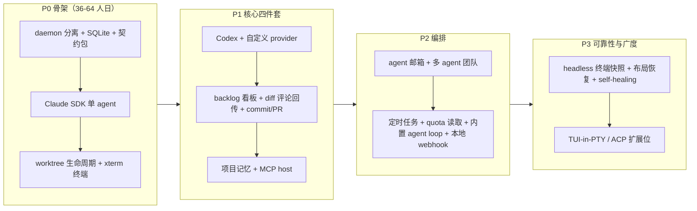

# Aether 产品需求文档（PRD）

> 版本：v0.1（草案） · 日期：2026-11-15 · 状态：待评审
> 依据：AgentsRoom 调研（`docs/research/agentsroom/`，下文引用格式为"调研 README / 01 / 02 / 05 / 06"）+ 项目所有者四项决策（开源、纯本地、双协议 provider、自定义可注册）。
> 配套文档（后续起草）：架构设计 `docs/architecture.md`、技术选型 ADR `docs/adr/`。

---

## 1. 愿景与定位

**一句话**：Aether 是一个开源、纯本地的 Electron 桌面应用——在一个窗口里编排多个项目 × 多个 AI coding agent（Claude Code 协议 / GPT 协议 / 自定义兼容端点），用你已付费的 CLI 订阅或自建模型端点干活，一切数据留在本机。

**一段话**：AgentsRoom 验证了 "Agent Development Environment (ADE)" 这一品类（调研 01：30 天 23 万次 agent 启动），但它是闭源商业软件、依赖其账号服务器。Aether 复刻的是它的**七条中的前六条设计公理**（调研 README；第七条 E2E relay 被纯本地排除）——不代理模型、执行权归 daemon、每 agent 一个 worktree、agent 分层接入、IDE 能力经 MCP 反向开放给 agent、可靠性第一——而不是它的 103 项功能。差异点有三：**开源**（MIT，已定 ADR-007）、**纯本地**（无账号、无云端、无 relay、无手机端）、**provider 自定义可注册**（除 Claude/GPT 双协议外，任意 Anthropic/OpenAI 兼容端点可配置接入）。对标开源竞品的空位：开源 + 本地优先 + 中文生态（调研 06 §10.1/§10.2）。

## 2. 目标用户与核心场景

**目标用户**：已订阅 Claude Code / Codex 等 CLI，或自建/中转模型端点（Anthropic/OpenAI 兼容）的个人开发者与小团队。前提假设是公理 1——用户自带算力，Aether 只做编排层与驾驶舱（调研 README 公理 1）。

以下四个场景故事从调研 01 的 103 项功能中选出最有价值的子集，构成 MVP 及后续版本的功能主线：

**S1 · 并行驾驶**（源自 01"多项目多 agent 一窗口 / Git worktrees / Agent status tracking"）

> 独立开发者老周同时维护 3 个项目。他在 Aether 网格里为每个任务开一个 agent，各自在独立 git worktree 分支上干活，主 checkout 永远干净；状态点（运行/等待/完成/出错）一眼扫过，谁在等输入就点进去答一句。

**S2 · 看板闭环**（源自 01"拖卡即启 agent / Vibe coding review / Per-agent review"）

> 老周把想法记成 backlog 票，拖进 Development 列即启动 agent。干完后他在 Changes 页逐文件看 diff、行内写评论，评论直接回传进 agent 会话驱动修改；满意后一键 commit / 提 PR。

**S3 · 模型对比**（源自 01"Compare coding agents"）

> 重构方案拿不准，老周把同一张票发给 Claude 与 Codex（以及一个自定义端点模型），各干一个 worktree；卡片对比文件数/行数/耗时与全量 diff，"Keep this one" 合并胜者。

**S4 · agent 反向驾驶**（源自 01"AgentsRoom MCP / Agent messaging / Agent delegation"）

> 任务变复杂后，dev agent 通过 MCP 工具自己读写 backlog 票、跑终端命令验证；两个 agent 互发邮件协作（P2），验证环节可 delegation 给便宜模型的临时 QA agent——编排能力本身就是产品（调研 README 公理 5）。

## 3. 功能需求（分期）

分期沿用复刻蓝图（调研 06 §7），按项目决策做纯本地重排：**删除 P4（relay/手机）全部内容**，剔除各期账号/云相关项；P2 保留 quota 读取（纯本地直读 `~/.claude/projects/` JSONL，见调研 01"Token usage"），剔除账号自动切换。

### 3.1 Provider 适配层（贯穿各期的接口决策）

三层分类法保留为接口形状，但 L3 语义按项目决策重定义（不再以 ACP/TUI-PTY 为扩展主线）：

- **统一接口 `AgentAdapter`**（spawn / spawnFollowUp / resume / cancel / dispose / normalizeLogs / discover / resolvePermission；`AdapterContext.loadEvents`）——**权威形状见 SYSTEM_DESIGN §6.2，本文不复述**。
- **kind 枚举**：`"claude-sdk" | "codex-app-server" | "custom"`（`"acp" | "tui"` 为 P2+ 预留枚举位）。
- **L3 自定义 provider**：配置驱动注册（`CustomProviderConfig`），用户无需写代码；协议枚举 `"anthropic" | "openai-chat" | "openai-responses"`（三协议法参考 happy-providers，见调研 05.D），支持任意兼容端点（自建网关 / 中转 / 本土模型）；`agentLoop` 取值 `"builtin"`（Aether 内置轻量工具循环，P2 落地）。

- **L1 SDK 层**：`@anthropic-ai/claude-agent-sdk`（stream-json，原生 Chat UI、会话谱系）——P0。
- **L2 专有协议层**：Codex app-server（JSON-RPC over stdio）——P1。
- **L3 自定义层**：按上述 `CustomProviderConfig` 配置驱动注册（provider_config + zod schema 校验 + discover 连通性/模型列表探测），Anthropic/OpenAI 兼容端点透传——P1；内置 agent loop 工具循环——P2。
- **ACP 与 TUI-in-PTY**：保留为 P2+ 扩展位（接口已兼容），MVP 不做（项目决策）。

### 3.2 P0 骨架（36-64 人日；人力假设：2 人全职 ≈ 4-6 周，1 人全职 ≈ 7-9 周）

| #    | 功能                                                                                                                                | 用户价值                                                                                                                                    | 验收标准                                                                                                             |
| ---- | ----------------------------------------------------------------------------------------------------------------------------------- | ------------------------------------------------------------------------------------------------------------------------------------------- | -------------------------------------------------------------------------------------------------------------------- |
| P0-1 | Electron 壳 + daemon 子进程分离（T3 式，主进程零领域逻辑）                                                                          | 会话恢复而非进程存活（公理 2）：渲染层崩溃无感存活；主进程崩溃/升级重启后 daemon 自动重启、从 SQLite 恢复全部状态、CLI 会话经 --resume 续聊 | kill 渲染进程后 agent 会话无感存活，重开 UI 重新接上；主进程重启后 daemon 自动重启并从 SQLite 恢复、会话可续聊       |
| P0-2 | 类型化契约包（UI ↔ daemon 唯一边界）                                                                                                | 前后端类型单一来源，防漂移                                                                                                                  | 契约包独立编译通过；UI/daemon 无契约外直连                                                                           |
| P0-3 | SQLite 单库（WAL）+ 核心数据模型（project→task→workspace→session→execution_process+logs，参考 VK+Orca，见调研 06 §4）               | 全部状态本地可查、可恢复                                                                                                                    | 迁移脚本可重复执行；断电重启后库不损坏                                                                               |
| P0-4 | Provider 框架 + Claude Code 协议适配（L1 stream-json）                                                                              | 第一批用户（Claude 占 AgentsRoom 实际用量 72%，见调研 01）跑通                                                                              | 单 agent 从 spawn 到产出 commit 的全过程状态机事件完整落库                                                           |
| P0-5 | xterm.js + node-pty 人类终端（PTY 在 daemon，仅供人类 shell；TUI-in-PTY 为 P2+ 扩展位）+ agent 活动事件流视图                       | 用户可在 worktree 打开人类终端直接交互；agent 活动可观察（事件流）、可跟问                                                                  | Windows ConPTY 下彩色/控制序列无乱码；进程树可完整击杀无孤儿（调研 06 §9.1）                                         |
| P0-6 | worktree 生命周期（创建/清理/持久预留，项目同级 `.aether-worktrees/` 目录，repo 外；不可写时回退 `userData/aether/worktrees/<id>`） | 主 checkout 永远干净（公理 3）                                                                                                              | 连续 20 次创建/销毁无残留目录与分支；启动前自动拷 `.env`（依赖安装钩子移 P1：P0 仅探测 npm/pnpm 并异步提示，不阻塞） |

**P0 端到端验收**（沿用调研 06 §7）：创建任务并启动 agent → worktree → Claude 执行 → diff 展示 → 跟问一条消息。

### 3.3 P1 核心四件套

| #    | 功能                                                                                                       | 用户价值                                                        | 验收标准                                                                            |
| ---- | ---------------------------------------------------------------------------------------------------------- | --------------------------------------------------------------- | ----------------------------------------------------------------------------------- |
| P1-1 | GPT 协议适配（Codex app-server JSON-RPC，L2）                                                              | 覆盖实际用量 91% 的双协议（调研 01：Claude 72% + Codex 19%）    | Claude 与 Codex 两 agent 并行各占一 worktree，主 checkout `git status` 不变         |
| P1-2 | 自定义 provider 注册（L3：provider_config + zod schema 校验 + discover 连通性/模型列表探测，三协议透传）   | 自建网关/中转/本土模型端点开箱即用（差异化点，见调研 06 §10.2） | 配置一个 Anthropic 兼容端点：保存并通过连通性/模型列表校验，全程无代码              |
| P1-3 | backlog 看板（拖卡即启 agent，列可配 prompt）                                                              | 想法 → 执行零摩擦（场景 S2）                                    | 拖票到 Development 列即拉起 agent 并关联该票                                        |
| P1-4 | diff 行内评论回传 agent                                                                                    | 审查意见直接变成 agent 的下一步输入                             | 评论在 30 秒内出现在对应会话并获得引用该评论的回复                                  |
| P1-5 | commit / PR（AI commit message，Conventional Commits；本地 commit 必做，push/PR 经用户自己的 gh 凭证可选） | 审查完一键落地                                                  | commit message 读真实 diff 生成、commit 落地；push/PR 为可选增强                    |
| P1-6 | 项目记忆（agent 写决策/架构/坑，跨会话、项目内共读）                                                       | agent 不重复踩坑（调研 01"Project memory"）                     | 新会话的 agent 能引用上一会话写入的记忆条目                                         |
| P1-7 | MCP host（127.0.0.1 HTTP + 每 console token；工具 = backlog 读写 + terminal + memory）                     | agent 反向驾驶 IDE（公理 5，场景 S4）                           | agent 经 backlog 工具读票并在完成时回写状态；礼仪：读免确认、写需请求（调研 06 §6） |

**P1 端到端验收**：两 agent 并行 + 审查闭环 + agent 能读 backlog（调研 06 §7）。

### 3.4 P2 编排

| #    | 功能                                                                                                             | 用户价值                                                | 验收标准                                                                                     |
| ---- | ---------------------------------------------------------------------------------------------------------------- | ------------------------------------------------------- | -------------------------------------------------------------------------------------------- |
| P2-1 | 自定义 provider 内置 agent loop（轻量工具循环）                                                                  | 无 CLI 订阅的纯 API 用户获得完整 agent 体验             | 端点完成一次任务：端点模型全程无代码、自主多轮调用工具（文件/终端范围待定，TBD-3）完成一张票 |
| P2-2 | agent 邮箱（照抄 AgentsRoom 协议：落盘投递、空闲间隙、read 语义、防循环限额、80% 强制 checkpoint，见调研 02 §h） | agent 间可靠协作（场景 S4）                             | 消息先落盘再投递；接收方忙则排队；投递状态由 SQL 触发器派生                                  |
| P2-3 | 多 agent 团队（配置先行，n8n 画布后置）                                                                          | Dev/QA/PM 角色分工                                      | 用配置文件声明 3 角色团队跑通一个含验证环节的任务                                            |
| P2-4 | 定时任务（免 cron 表达式，错过补跑）                                                                             | 配额窗口/夜间自动开工                                   | 到点触发创建会话；关机错过的任务开机补跑                                                     |
| P2-5 | quota 读取（直读 `~/.claude/projects/` JSONL）                                                                   | 订阅制时代的真实痛点（调研 01 判断 2）                  | token 用量表与官方口径一致；过阈值本地通知（只监控不预测，调研 06 §9.5）                     |
| P2-6 | ACP 接入扩展位（agent-client-protocol + 能力发现）                                                               | 长尾 CLI 统一接入的备用通道                             | TBD：是否落地及验收由 P2 末评估（TBD-7）                                                     |
| P2-7 | 本地 webhook（监听 127.0.0.1，供本机 CI/cron 触发）                                                              | 本机自动触发入口（公网 webhook 需公网端点，纯本地不设） | 收到本地 POST 后创建任务并启动 agent；端口仅绑定 127.0.0.1                                   |

### 3.5 P3 可靠性与广度

| #    | 功能                                                                    | 用户价值                                                       | 验收标准                                        |
| ---- | ----------------------------------------------------------------------- | -------------------------------------------------------------- | ----------------------------------------------- |
| P3-1 | headless xterm 快照（@xterm/headless 权威仿真 + SerializeAddon）        | 多客户端无损 attach、Chat↔Terminal 互切（Orca 式，调研 06 §3） | 重连客户端拿到快照+增量，画面与在线端一致       |
| P3-2 | 布局恢复 / Restore session                                              | 次日开机回到昨天的驾驶舱                                       | 退出时快照，重启后 agent/终端/布局精确还原      |
| P3-3 | self-healing / Process Guard（"大+老+CPU 空闲"三条件判卡死，见调研 01） | 长时间无人值守不烂尾                                           | 模拟卡死进程被正确识别并处置；正常进程零误杀    |
| P3-4 | 崩溃恢复（SQLite 投影 + outbox 简化事件溯源，见调研 06 §4）             | 断电/崩溃后任务状态不丢                                        | kill -9 daemon 后重启，运行中任务恢复到一致状态 |

**P3 端到端验收**（沿用调研 06 §7）：崩溃恢复演示。
TUI-in-PTY 广度层（一个枚举接任意 CLI + per-provider 终端流解析）按项目决策为 P2+ 扩展位，若启动则落在本期之后；多账号口径为"不做 Aether 自身账号体系"，CLI 多开（HOME 目录隔离）为 P3 扩展位，是否纳入待定（TBD-4）。

## 4. 非目标（明确排除）

| 排除项                               | 理由                                                                                      |
| ------------------------------------ | ----------------------------------------------------------------------------------------- |
| 账号体系 / 用户登录                  | 项目决策：纯本地，无服务器侧用户概念                                                      |
| 云端 / 云 agent / relay（E2EE 中继） | 项目决策：一切数据本地存储；调研 06 §7 P4 整期不做                                        |
| 手机端 / 手机遥控 / 推送到手机       | 依赖 relay，同上排除                                                                      |
| 多机 fleet / 跨机接续 / machine pool | 依赖 relay，排除                                                                          |
| 公网 webhook / 公网反馈门户          | 需要公网端点，与纯本地冲突                                                                |
| 模型代理 / token 转售                | 公理 1：BYOK，从 PATH 检测 CLI、spawn 真实进程（调研 README）                             |
| TUI 终端流解析（MVP）                | L1/L2 有结构化协议事件，状态直接来自协议（调研 06 §5）；流解析仅在 P2+ TUI 扩展位启用时做 |
| ACP（MVP）                           | 项目决策：P2+ 扩展位                                                                      |
| non-dev 业务角色模式                 | AgentsRoom 的非开发者市场转向，MVP 不跟（聚焦开发者）                                     |
| 工单系统导入（Linear/Jira 等）       | 只读外部集成，MVP 无此依赖；后置评估                                                      |

## 5. 成功指标

**P0（骨架成立）**

1. 干净的 Windows 11 开发机上，从 clone 源码 + pnpm install 到完成"创建任务并启动 agent → worktree → Claude 执行 → diff 展示 → 跟问一条消息"全链路 ≤ 30 分钟操作（不含 CLI 登录；安装包口径的同类指标移 P3）。
2. Windows ConPTY 下 Claude CLI 彩色输出/进度条渲染无乱码；agent 进程树击杀后无孤儿进程（任务管理器验证）。
3. daemon 领域逻辑（provider 适配、worktree、存储）测试覆盖率 ≥ 80%（vitest，TDD 决策）；连续 20 次 worktree 创建/销毁零残留。

**P1（核心闭环成立）**

1. Claude + Codex 两 agent 并行执行不同票，各自 worktree 独立，全程主 checkout 干净、互不干扰（并发 2 小时无错乱）。
2. diff 行内评论 → agent 会话 → 修改后的新 diff 三步闭环成功率 100%（10 次人工验收全过）。
3. agent 经 MCP backlog 工具读票并回写状态；自定义 provider（Anthropic 兼容端点）以纯配置完成注册并通过连通性校验——两类验证各跑通 5 次；集成 + Playwright E2E 用例覆盖四件套主路径且 CI 全绿。

## 6. 开源定位

### 6.1 许可证（已拍板：MIT——ADR-007，2026-11-15；LICENSE 落仓库根）

**已定 MIT**（原建议，理由存档）：

1. **生态一致性**：头部同类 Orca（124.8k★）/ T3（60.2k★）/ Happy（24.6k★）均为 MIT（调研 04/README 竞品表），目标贡献者池无心理门槛。
2. **复用依赖无摩擦**：计划复用的 `electron-mcp-server`（AgentsRoom 自家）为 MIT（调研 06 §8）；MIT 项目引用 Apache-2.0 的 VK 代码（若接盘）只需保留 NOTICE，同样可行。
3. **简洁**： shortest and most understood；开源桌面工具事实标准。

**备选 Apache-2.0**：显式专利授权条款对贡献者/使用者双方保护更完整，且 VK（Apache-2.0）若成为重要代码来源时同许可证合并最省心。代价是文本更长、个人贡献者略陌生。**不建议** Copyleft（GPL/MPL）：会劝退商业场景的潜在贡献方，与"开放生态"定位相悖。

### 6.2 仓库治理路线图

| 阶段  | 动作                                                                                                                                                                                                    |
| ----- | ------------------------------------------------------------------------------------------------------------------------------------------------------------------------------------------------------- |
| P0 前 | `README.md`（定位、与 AgentsRoom/竞品的关系声明、快速上手、截图）、`LICENSE`、`CONTRIBUTING.md`（环境搭建、TDD 流程、提交规范 conventional commits）、`SECURITY.md`（本地安全模型：token/密钥永不出机） |
| P0 末 | `CODE_OF_CONDUCT.md`、issue/PR 模板、中文/英文双语 README、`docs/` 目录（PRD/架构/ADR 公开）                                                                                                            |
| P1 末 | 语义化版本 + CHANGELOG 自动生成、首个 tagged release、good-first-issue 标签体系、provider 适配器贡献指南（如何注册自定义 provider）                                                                     |
| P2 起 | 路线图公开（本 PRD §3 即雏形）、RFC 流程（大特性先 issue 讨论）、CORE_TEAM 与权限说明                                                                                                                   |

**边界声明**（写入 README 首屏）：Aether 是独立开源项目，非 AgentsRoom 的破解/仿冒；不代理模型、不经手任何 token；所有商标归各自所有者。

---

## 附：待定项（TBD）汇总

| 编号            | 问题                                                                                   | 影响范围   |
| --------------- | -------------------------------------------------------------------------------------- | ---------- |
| （已关闭）TBD-1 | 许可证已拍板 MIT（ADR-007，2026-11-15），LICENSE 落仓库根                              | §6.1、仓库 |
| TBD-3           | 内置 agent loop 的工具范围与权限模型（文件读写？shell？确认礼仪）                      | §3.4 P2-1  |
| TBD-4           | CLI 多开（HOME 目录隔离）是否纳入 P3 扩展位（口径：不做 Aether 自身账号体系）          | §3.5       |
| TBD-5           | 本土 CLI（Qwen Code / Kimi / GLM-ZCode / MiniMax）是否作为自定义 provider 预设模板分发 | §3.1       |
| TBD-7           | ACP 扩展位是否在 P2 末落地及验收标准                                                   | §3.4 P2-6  |
