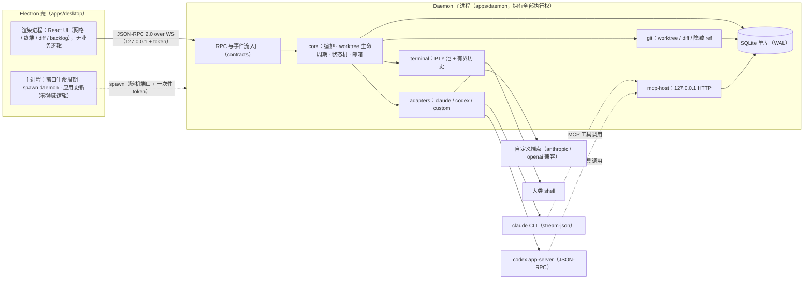
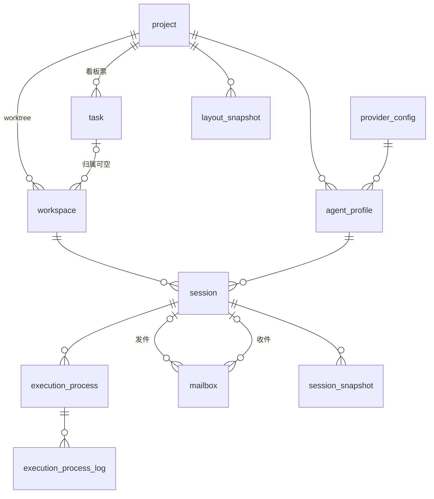

# Aether 系统设计文档

> 状态：草案 v0.1（2026-11-15）· 上游依据：`docs/research/agentsroom/`（下文引用写作"调研 XX"）
> 决策来源（项目所有者已拍板）：①按调研建议落地 ②Provider 支持 Claude Code 协议 + GPT 协议，且可自定义注册 ③无账号、无云端、纯本地 ④开源（**MIT**，ADR-007 已确认 2026-11-15，LICENSE 已落仓库根）
> 本文范围：系统结构（目录 / 模块 / 数据模型 / RPC 契约 / Provider 适配 / 终端子系统）。产品功能选型与任务拆分另文。
> 接口权威：本文档 §6.2 为适配器接口（AgentAdapter 等）的全仓唯一权威定义，其余文档引用不复述。

## 1. 设计总览

### 1.1 定位与硬约束

Aether 是开源 Electron 桌面应用（TypeScript）：多项目 × 多 agent 编排驾驶舱，复刻 AgentsRoom 的七条设计公理中的前六条（见调研 README），明确不继承公理 7（E2E relay / 手机端）。一切数据本地存储。

| 约束        | 内容                                                                                                                                  | 出处                 |
| ----------- | ------------------------------------------------------------------------------------------------------------------------------------- | -------------------- |
| 形态        | Electron + TypeScript + pnpm monorepo                                                                                                 | 调研 06 §0           |
| 执行权      | 独立 daemon 拥有全部执行；Electron 主进程零领域逻辑                                                                                   | 调研 05.B #1         |
| Provider    | Claude Agent SDK（stream-json）+ Codex app-server（JSON-RPC over stdio）+ 自定义可注册（Anthropic/OpenAI 兼容端点 + 内置 agent loop） | 用户拍板；调研 06 §2 |
| 纯本地      | 无账号 / 无云端 / 无 relay / 无手机端；数据仅本地 SQLite                                                                              | 用户拍板             |
| 不做（MVP） | ACP、TUI-in-PTY、终端流解析——接口预留为 P2+ 扩展位                                                                                    | 调研 06 §2/§5        |
| 开源        | MIT（ADR-007 已确认 2026-11-15；LICENSE 落仓库根）                                                                                    | 用户拍板             |

### 1.2 总体架构（daemon 分离，T3 式）



要点（全部来自调研结论）：

- **主进程只做三件事**：窗口生命周期、把 daemon 拉起为子进程并传 token、应用更新。diff / Git / 状态推断全部在 daemon——即使主进程技术上够得着 Node API 也不准做（Environment 所有权模型，见调研 05.B #1）。
- **daemon 可脱离 Electron 无头运行**：同一份代码将来直接服务 CLI / 集成测试场景（见调研 05.A #4）。MVP 取 T3 式"桌面子进程 + 契约包"，Orca 式终端独立 daemon 留给可靠性阶段（见调研 06 §1）。
- **不做模型代理**：用户已付费的 CLI 订阅或自有 API key 是算力来源；Aether 从 PATH 检测 CLI、spawn 真实进程，不碰 token 转售（公理 1，见调研 README）。
- **传输安全**：daemon 绑 `127.0.0.1` 随机端口，主进程 spawn 时经 argv/env 注入一次性 token，每连接握手校验（WS 连接即认证域：回环绑定 + 逐连接鉴权下，与逐帧校验等价；Orca hello+token、Happy bearer token 的做法，见调研 05.A/05.D）。

## 2. Monorepo 目录结构（pnpm workspace）

```text
aether/
├─ apps/
│  ├─ desktop/          # Electron 壳：主进程（零领域逻辑：窗口 / spawn daemon / 更新）+ 渲染进程（React UI）
│  └─ daemon/           # 独立 daemon：RPC 与事件流入口，组装 core/adapters/terminal/storage/process-host/mcp-host，可无头运行
├─ packages/
│  ├─ contracts/        # 类型化 RPC 契约与事件 schema（zod 单一来源，零运行时依赖，桌面与 daemon 唯一边界）
│  ├─ core/             # 领域核心：编排、worktree 生命周期、任务流、邮箱、状态机、AgentAdapter 端口 + 跨包共享工具（不设独立 shared 包；纯逻辑，可无头测试）
│  ├─ adapters/
│  │  ├─ claude/        # L1 适配：@anthropic-ai/claude-agent-sdk（stream-json）
│  │  ├─ codex/         # L2 适配：Codex app-server（JSON-RPC over stdio）
│  │  └─ custom/        # 自定义 provider：anthropic / openai-chat / openai-responses 三协议客户端 + 内置 agent loop
│  ├─ terminal/         # PTY 池与会话管理（node-pty）、有界历史、渲染帧协议
│  ├─ storage/          # SQLite（WAL）访问层 + 手写迁移链 + outbox
│  ├─ process-host/     # 子进程宿主与治理：spawn / 进程组树杀 / 退出证明 / Windows 隐藏控制台窗口（execution_process 的运行时对应物），adapters 复用
│  └─ mcp-host/         # 本地 MCP host（P1 建；127.0.0.1 HTTP + per-console token）：backlog / terminal / memory 工具家族
├─ fixtures/            # aether-mock-cli 等测试夹具（非 workspace 包、不发布）
├─ docs/                # 调研与设计文档
├─ pnpm-workspace.yaml
└─ package.json
```

**依赖方向规则**（用 CI lint 棘轮固化为硬约束，Orca 做法，见调研 05.A #6）：

1. `contracts` 不依赖任何 workspace 包（仅 zod）。
2. `core` → `contracts`（跨包共享工具并入 `core`，不设独立 shared 包）；`adapters/*` → `core` + `contracts` + `process-host`（实现 core 定义的端口，复用进程治理原语）；`process-host` / `terminal` / `storage` → `contracts`（按需）；`mcp-host`（P1 建）→ `core` + `storage` + `contracts`。
3. `apps/daemon` → 全部 server 侧包；`apps/desktop` → 仅 `contracts`（渲染）+ 自带的 daemon 启动器。
4. 渲染进程禁止引入 Node 内置模块做领域操作；一切领域数据必须过契约边界。

## 3. 模块清单

| 模块                     | 职责                                                                                                                                                                           | 依赖                                                                   | 调研参考                            |
| ------------------------ | ------------------------------------------------------------------------------------------------------------------------------------------------------------------------------ | ---------------------------------------------------------------------- | ----------------------------------- |
| apps/desktop 主进程      | 窗口生命周期、spawn/监护 daemon、更新                                                                                                                                          | contracts、daemon 启动器                                               | 05.B                                |
| apps/desktop 渲染进程    | 网格 / 终端视图 / agent 卡片 / diff 审查 / backlog；状态由事件流驱动，无业务逻辑                                                                                               | contracts                                                              | 05.A                                |
| apps/daemon              | RPC 入口、进程生命周期、组装各包                                                                                                                                               | core、adapters/*、terminal、storage、process-host、mcp-host、contracts | 05.B                                |
| packages/contracts       | RPC 方法、事件 envelope、实体类型的单一来源                                                                                                                                    | zod                                                                    | 05.B #4、05.C（ts-rs 单一来源思想） |
| packages/core            | 编排、worktree 生命周期、任务流、邮箱、状态机、AgentAdapter 端口                                                                                                               | contracts                                                              | 05.A #5、06 §4                      |
| packages/adapters/claude | L1：SDK spawn、stream-json 事件归一化、resume                                                                                                                                  | core、contracts、process-host                                          | 05.A、05.C                          |
| packages/adapters/codex  | L2：app-server JSON-RPC、事件归一化（方法级细节实现前实测核对，TBD-5）                                                                                                         | core、contracts、process-host                                          | 05.B、05.C                          |
| packages/adapters/custom | 自定义 provider：三协议客户端 + 内置最小 agent loop                                                                                                                            | core、contracts、process-host                                          | 05.D（happy-providers）             |
| packages/terminal        | PTY 池、会话管理、有界历史、渲染帧协议                                                                                                                                         | contracts                                                              | 05.B #5、05.C                       |
| packages/storage         | SQLite 访问层、迁移链、outbox                                                                                                                                                  | contracts                                                              | 05.A、05.C                          |
| packages/process-host    | 子进程宿主与治理：spawn、进程组树杀、退出证明、Windows 隐藏控制台窗口（树杀机制：POSIX 进程组 kill(-pgid)；Windows taskkill /T /F——零原生模块定案，Job 对象连带杀为 P1+ 增量） | contracts（按需）                                                      | 06 §9                               |
| packages/mcp-host        | MCP host 与工具家族、token 鉴权、注入 CLI 配置（P1 建）                                                                                                                        | core、storage、contracts                                               | 06 §6、02.d                         |

## 4. 数据模型（SQLite 单库）

### 4.1 总则

- 引擎：**SQLite 单库 + WAL**；驱动定案 `node:sqlite`（Node 22+ 内置，Orca/T3 生产先例、免原生 rebuild，见调研 05.A/05.B）；P0-01 内完成 spike 验证 `ELECTRON_RUN_AS_NODE` 模式可用，唯一回退条件 = spike 失败则 `better-sqlite3`（需随 Electron ABI 重编原生模块）。
- 连接后固定执行：`PRAGMA journal_mode=WAL; PRAGMA foreign_keys=ON; PRAGMA busy_timeout=5000;`
- 主键：业务表用 TEXT（uuid v4）；append-only 日志表用 INTEGER（rowid）。时间一律 UTC ISO-8601 字符串。
- 迁移：手写递增迁移链 + `schema_migrations` 表（Orca 式，见调研 05.A）；事件溯源 v2 不做，MVP 用"SQLite 投影 + outbox"简化版（见调研 06 §4）。
- 实体骨架参考 Vibe Kanban 的 project→task→workspace→session→execution_process 链 + Orca 的 mailbox 编排表（见调研 05.C/05.A）。



### 4.2 表结构 DDL

```sql
CREATE TABLE project (
  id                 TEXT PRIMARY KEY,
  name               TEXT NOT NULL,
  root_path          TEXT NOT NULL UNIQUE,   -- 规范化绝对路径即身份（见调研 05.D）
  git_default_branch TEXT NOT NULL DEFAULT 'main',
  settings_json      TEXT NOT NULL DEFAULT '{}',  -- per-project 设置（MCP 家族开关等）
  created_at         TEXT NOT NULL,
  archived_at        TEXT
);

CREATE TABLE task (
  id                      TEXT PRIMARY KEY,
  project_id              TEXT NOT NULL REFERENCES project(id) ON DELETE CASCADE,
  parent_task_id          TEXT REFERENCES task(id) ON DELETE SET NULL,  -- 自引用（见调研 05.C）
  title                   TEXT NOT NULL,
  description             TEXT NOT NULL DEFAULT '',
  status                  TEXT NOT NULL DEFAULT 'todo'
                          CHECK (status IN ('todo','in_progress','in_review','done','cancelled')),  -- 见调研 05.C
  assignee_agent_profile_id TEXT REFERENCES agent_profile(id) ON DELETE SET NULL,
  position                REAL NOT NULL DEFAULT 0,   -- 看板排序
  created_at              TEXT NOT NULL,
  updated_at              TEXT NOT NULL
);
CREATE INDEX idx_task_project_status ON task(project_id, status);

CREATE TABLE workspace (
  id            TEXT PRIMARY KEY,
  project_id    TEXT NOT NULL REFERENCES project(id) ON DELETE CASCADE,
  task_id       TEXT REFERENCES task(id) ON DELETE SET NULL,
  name          TEXT NOT NULL UNIQUE,      -- 持久预留先行：先插行再动 Git（见调研 05.D #3）
  branch        TEXT NOT NULL,
  worktree_path TEXT NOT NULL UNIQUE,   -- 项目同级 .aether-worktrees/<name>/（repo 外，不弄脏主 checkout）；不可写时回退 userData/aether/worktrees/<id>/
  storage_key   TEXT NOT NULL,             -- 崩溃恢复用的存储键
  status        TEXT NOT NULL DEFAULT 'reserved'
                CHECK (status IN ('reserved','creating','ready','archived','deleting','failed','orphaned')),
                -- 枚举唯一来源 @aether/contracts（WorkspaceStatus）；崩溃恢复扫描 creating/deleting/orphaned
  created_at    TEXT NOT NULL,
  released_at   TEXT
);
CREATE INDEX idx_workspace_project ON workspace(project_id, status);

CREATE TABLE provider_config (
  id           TEXT PRIMARY KEY,
  kind         TEXT NOT NULL CHECK (kind IN ('claude-sdk','codex-app-server','custom')),
  display_name TEXT NOT NULL,
  config_json  TEXT NOT NULL DEFAULT '{}',  -- kind=custom 时存 §6.3 的 schema（zod 校验后入库）
  created_at   TEXT NOT NULL,
  updated_at   TEXT NOT NULL
);
-- Driver(kind) 与 Instance(配置行) 分离：同一 kind 可挂多套配置（见调研 05.B #4）

CREATE TABLE agent_profile (
  id                 TEXT PRIMARY KEY,
  project_id         TEXT REFERENCES project(id) ON DELETE CASCADE,  -- NULL=全局可用
  name               TEXT NOT NULL,
  provider_config_id TEXT NOT NULL REFERENCES provider_config(id) ON DELETE RESTRICT,
  model              TEXT,                  -- 覆盖 provider 默认模型
  persona            TEXT NOT NULL DEFAULT '',   -- 系统 prompt 增量（约 6000 字符内每轮重发，见调研 02.g）
  autonomy_json      TEXT NOT NULL DEFAULT '{}', -- 权限/bypass 旗标映射（见调研 02.g）
  created_at         TEXT NOT NULL,
  updated_at         TEXT NOT NULL,
  UNIQUE (project_id, name)
);

CREATE TABLE session (
  id                  TEXT PRIMARY KEY,
  workspace_id        TEXT NOT NULL REFERENCES workspace(id) ON DELETE CASCADE,
  agent_profile_id    TEXT NOT NULL REFERENCES agent_profile(id) ON DELETE RESTRICT,
  external_session_id TEXT,                -- 供 --resume（见调研 05.C executor_sessions）
  status              TEXT NOT NULL DEFAULT 'starting'
                      CHECK (status IN ('starting','ready','running','waiting','stopped','error')),  -- T3 状态机，见调研 05.B
  lineage_parent_id   TEXT REFERENCES session(id) ON DELETE SET NULL,  -- 会话谱系（见调研 05.A）
  checkpoint_ref      TEXT,                -- 隐藏 git ref，不产生用户可见 commit（见调研 06 §4）
  created_at          TEXT NOT NULL,
  last_active_at      TEXT NOT NULL
);
CREATE INDEX idx_session_workspace ON session(workspace_id, status);

CREATE TABLE execution_process (
  id           TEXT PRIMARY KEY,
  session_id   TEXT NOT NULL REFERENCES session(id) ON DELETE CASCADE,
  run_reason   TEXT NOT NULL
               CHECK (run_reason IN ('setup','cleanup','dev_server','coding_agent','follow_up')),  -- 见调研 05.C
  pid          INTEGER,
  command_json TEXT NOT NULL,              -- argv + env 变量名列表（不含密钥值）
  status       TEXT NOT NULL DEFAULT 'running'
               CHECK (status IN ('running','exited','killed','failed')),
  exit_code    INTEGER,
  started_at   TEXT NOT NULL,
  ended_at     TEXT
);
CREATE INDEX idx_process_session ON execution_process(session_id, started_at);

CREATE TABLE execution_process_log (
  id              INTEGER PRIMARY KEY,     -- rowid，append-only
  process_id      TEXT NOT NULL REFERENCES execution_process(id) ON DELETE CASCADE,
  seq             INTEGER NOT NULL,        -- 进程内单调序号
  raw_json        TEXT NOT NULL,           -- JSONL 原样落库（见调研 05.C #5）
  normalized_json TEXT,                    -- normalizeLogs 旁路回填；NULL=尚未归一化
  created_at      TEXT NOT NULL
);
CREATE INDEX idx_logs_process_seq ON execution_process_log(process_id, seq);

CREATE TABLE mailbox (
  id                  TEXT PRIMARY KEY,
  project_id          TEXT NOT NULL REFERENCES project(id) ON DELETE CASCADE,
  from_session_id     TEXT REFERENCES session(id) ON DELETE SET NULL,  -- NULL=人类/系统
  from_kind           TEXT NOT NULL DEFAULT 'agent'
                      CHECK (from_kind IN ('agent','human','system')),
  to_session_id       TEXT REFERENCES session(id) ON DELETE SET NULL,
  to_agent_profile_id TEXT REFERENCES agent_profile(id) ON DELETE SET NULL,
  subject             TEXT NOT NULL,
  body                TEXT NOT NULL,
  status              TEXT NOT NULL DEFAULT 'queued'
                      CHECK (status IN ('queued','delivered','read','accepted','declined','answered')),  -- 见调研 02.h
  delivered_at        TEXT,
  read_at             TEXT,
  answered_at         TEXT,
  created_at          TEXT NOT NULL
);
CREATE INDEX idx_mailbox_to_status ON mailbox(to_session_id, status);
CREATE INDEX idx_mailbox_project_created ON mailbox(project_id, created_at);
-- 存投分离：消息先落库再投递；投递状态由 SQL 触发器派生（Orca mailbox 模式，见调研 05.A）。
-- 防循环限额（如 12 条/30 收件人/10 分钟，见调研 02.h）等业务规则放 core 层而非 schema 层，常量待定 TBD-6。

CREATE TABLE layout_snapshot (
  id           INTEGER PRIMARY KEY,
  scope        TEXT NOT NULL CHECK (scope IN ('app','project')),
  project_id   TEXT REFERENCES project(id) ON DELETE CASCADE,  -- scope=project 时非空
  seq          INTEGER NOT NULL,           -- 单 scope 内单调递增
  payload_json TEXT NOT NULL,              -- 面板网格 / 终端 pane / 会话卡片位置
  created_at   TEXT NOT NULL
);
CREATE INDEX idx_layout_scope ON layout_snapshot(scope, project_id, seq DESC);
-- 快照节奏参考 AgentsRoom 的"变更后最多 15 秒落盘"（见调研 02.a/README 公理 6），具体节奏待定 TBD-7。

CREATE TABLE session_snapshot (
  id           INTEGER PRIMARY KEY,
  session_id   TEXT NOT NULL REFERENCES session(id) ON DELETE CASCADE,
  kind         TEXT NOT NULL CHECK (kind IN ('view','resume')),
  payload_json TEXT NOT NULL,  -- view=UI 视图态（滚动位置/tab/展开态）；resume=重 spawn 元数据（外部会话 id、transcript 路径、能力标志）
  created_at   TEXT NOT NULL
);
CREATE INDEX idx_session_snapshot ON session_snapshot(session_id, kind, created_at DESC);

CREATE TABLE schema_migrations (
  version    INTEGER PRIMARY KEY,
  name       TEXT NOT NULL,
  applied_at TEXT NOT NULL
);
```

### 4.3 说明

- **会话恢复差异要诚实**：仅部分 CLI 真支持 resume；`capabilities.canResume=false` 时 UI 明示"只能新会话+喂 transcript"（见调研 06 §9.2）。
- **日志写路径与保留策略**（定案）见 §4.4。
- checkpoint 走隐藏 git ref 存 `session.checkpoint_ref`，不建独立表（见调研 06 §4）。

### 4.4 日志写路径（execution_process_log，定案）

- **写路径**：进程原始输出先进 daemon 内存批量缓冲，定时（如 200ms）或定量（如 500 行）触发 flush，以**单事务**批量 INSERT；缓冲与 flush 后台执行，不阻塞状态机事件与查询。
- **单行截断**：阈值 1MiB；超出部分溢出写入旁文件（sidecar），行内只留截断标记与旁文件引用（路径 + 偏移），超长原始行不整行入库。
- **保留策略**：按量 + 按天双重清理——超容量配额删最老进程的日志，超保留天数的定期清理；均后台执行。

## 5. IPC / RPC 契约（packages/contracts）

### 5.1 形态与传输

- **单一来源**：全部 RPC 方法、事件 envelope、实体类型以 zod schema 定义，`z.infer` 导出 TS 类型（对标 T3 contracts 包与 VK"结构体三派生"的单一来源思想，见调研 05.B/05.C）。desktop 与 daemon 都只 import 这个包，改协议必须改这里。
- **传输**：JSON-RPC 2.0 over WebSocket。daemon 绑 `127.0.0.1` 随机端口；主进程 spawn 时注入端口号 + 一次性 token（argv/env）；连接先 hello 握手校验 token 与协议版本（见调研 05.A）。纯本地，不出网。
- 渲染进程直连 daemon WS；若 Electron sandbox/CSP 阻碍则退化为"主进程消息通道转发"（同帧格式不变）——待定 TBD-3。

### 5.2 方法分组

| 组         | 职责                    | 代表方法                                                |
| ---------- | ----------------------- | ------------------------------------------------------- |
| projects   | 项目 CRUD / 归档 / 设置 | list / create / archive                                 |
| tasks      | backlog 票              | create / move / assign / comment                        |
| workspaces | worktree 生命周期       | createForTask / release / cleanupOrphans                |
| agents     | 会话与 provider         | spawn / followUp / resume / cancel / permission.respond |
| terminals  | 人类终端                | create / write / resize / kill                          |
| diff       | 审查闭环                | workspaceDiff / requestChanges / approve                |
| mcp        | MCP host 配置与状态     | listTools / toggleFamily                                |
| system     | daemon 自身             | health / version / shutdown                             |

### 5.3 签名示例（5 个，类型均出自 contracts）

```ts
export interface AetherRpc {
  "projects.list"(): { items: ProjectSummary[] };

  "tasks.create"(input: {
    projectId: string;
    title: string;
    description?: string;
    parentId?: string;
  }): Task;

  "agents.spawn"(input: {
    taskId: string;
    workspaceId?: string; // 缺省则按持久预留先行新建 worktree
    agentProfileId: string;
    prompt: string;
    autonomy?: AutonomyLevel; // 'read_only' | 'workspace_write' | 'auto'（映射见 §6.2）
  }): SessionHandle;

  "terminals.create"(input: {
    projectId: string;
    workspaceId?: string;
    cwd: string;
    cols: number;
    rows: number;
  }): TerminalHandle;

  "diff.workspaceDiff"(input: { workspaceId: string }): DiffResult;
}
```

### 5.4 事件流（订阅推送）

```ts
export interface EventEnvelope<T = unknown> {
  topic: string;        // 点分层级，支持通配下钻，如 "session.<id>.events"
  seq: number;          // daemon 全局单调递增
  emittedAt: string;    // UTC ISO-8601
  payload: T;           // zod 校验后的强类型
}

// 订阅：带 cursor 做断线重放；cursor 早于保留水位时返回全量快照指令（T3 模式，见调研 05.B）
'subscribe'(input: { topics: string[]; cursor?: number }):
  { cursor: number; snapshot?: StateSnapshot };
```

| Topic                                                                    | 内容                              |
| ------------------------------------------------------------------------ | --------------------------------- |
| `session.<id>.events`                                                    | ProviderEvent 归一化流 + 状态迁移 |
| `session.<id>.state`                                                     | 状态机迁移（§8.1）                |
| `terminal.<id>.output`                                                   | 终端增量帧（§7.3）                |
| `process.<id>.logs`                                                      | 新日志行通知（拉取或内联）        |
| `task.updated` / `mailbox.updated` / `workspace.status` / `agent.status` | 投影变更                          |

设计依据：VK 的"DB 写钩子生成补丁 + 单条 SSE 合并 history+live"与 T3 的"cursor 重放 + 水位前改快照恢复"（见调研 05.C/05.B）。MVP 用**有界内存缓冲重放**（缓冲水位待定 TBD-9），不实现全量 DB 补丁流。

## 6. Provider 适配器接口

### 6.1 三层分类与 Aether 映射

| 层          | 公理 4 的分类（见调研 README）                                                                               | Aether 落点                       | 阶段 |
| ----------- | ------------------------------------------------------------------------------------------------------------ | --------------------------------- | ---- |
| L1 SDK      | Claude Agent SDK（stream-json，原生 Chat UI、会话谱系）                                                      | packages/adapters/claude          | P0   |
| L2 专有协议 | Codex app-server（JSON-RPC over stdio）                                                                      | packages/adapters/codex           | P1   |
| L3 自定义   | happy-providers 思路：anthropic / openai-chat / openai-responses 三协议 + 轻量内置 agent loop（见调研 05.D） | packages/adapters/custom          | P1   |
| L3 广度     | ACP、TUI-in-PTY（终端流解析 + per-provider 规则）                                                            | 接口预留（kind 枚举占位），不实现 | P2+  |

### 6.2 核心接口（定义在 packages/core，adapters 实现）

```ts
export type ProviderKind = 'claude-sdk' | 'codex-app-server' | 'custom' | 'acp' | 'tui';
// 'acp' | 'tui' 为 P2+ 扩展位占位，MVP 不注册实现

export type AutonomyLevel = 'read_only' | 'workspace_write' | 'auto';
// 权限模式映射参考 Happy：read_only→plan / workspace_write→acceptEdits / auto→auto（见调研 05.D）

export type PermissionDecision = 'approve' | 'deny';

export interface AdapterCapabilities {
  canResume: boolean;           // 仅部分 CLI 真支持（见调研 06 §9.2）
  followUpAtMessage: boolean;   // --resume-session-at 级精度（见调研 05.C）
  permissionFlags: boolean;     // 各 CLI 自有的 bypass/权限旗标（见调研 02.g）
  structuredEvents: boolean;    // L1/L2=true；tui 预留 false（终端流解析，P2+）
  protocols: readonly string[]; // custom 用：'anthropic' | 'openai-chat' | 'openai-responses'
}

export interface AgentAdapter {
  readonly kind: ProviderKind;
  readonly capabilities: AdapterCapabilities;
  /** 环境探测：CLI 在 PATH？端点可达？缺失则返回安装指引，不静默失败（见调研 02.a） */
  discover(): Promise<DiscoverResult>;
  /** 新会话：spawn agent 进程（core 先建 session/workspace 行，持久预留先行） */
  spawn(input: SpawnInput, ctx: AdapterContext): Promise<AgentProcess>;
  /** 同会话追问：走 --resume <externalSessionId>（见调研 05.C） */
  spawnFollowUp(proc: AgentProcess, input: { message: string }, ctx: AdapterContext): Promise<void>;
  /** 断线/重启后恢复；canResume=false 时 UI 明示只能新会话 */
  resume(session: SessionRecord, ctx: AdapterContext): Promise<AgentProcess>;
  /** 双向取消契约：用户取消与进程退出互为因果（VK SpawnedChild，见调研 05.C #2） */
  cancel(proc: AgentProcess, reason: CancelReason): Promise<void>;
  /** 权限应答：对 waiting 中的 permission_request 批准/拒绝，解除 waiting 状态（RPC：agents.permission.respond） */
  resolvePermission(processId: string, requestId: string, decision: PermissionDecision): Promise<void>;
  /** 原始日志行数组 → 归一化事件数组（旁路转换器，vendor 格式变化只改一处，见调研 05.C #5） */
  normalizeLogs(raw: unknown[]): ProviderEvent[];
  dispose(): Promise<void>;
}

export interface AgentProcess {
  readonly processId: string;                      // = execution_process.id
  readonly pid: number | null;
  readonly cancel(reason: CancelReason): Promise<void>;
  readonly exited: Promise<{ code: number | null; signal?: string }>;  // 退出证明（见调研 05.A）
}

export interface AdapterContext {
  emit(ev: ProviderEvent): void;    // → 状态机 + 落库
  worktreePath: string;             // agent 的 cwd
  env: Record<string, string>;      // 注入的 env 变量名→值；值永不落库
  loadEvents(sessionId: string): Promise<ProviderEvent[]>;  // 自定义 provider resume 时重水化历史事件
}
```

`ProviderEvent`（归一化事件联合类型：`status` / `message` / `tool_use` / `tool_result` / `permission_request` / `session` / `error`）定义在 contracts，renderer 与 daemon 共享。L1/L2 的事件结构以官方协议为准，实现前逐项核对（Codex app-server 方法级细节待定 TBD-5；不凭空编造，见调研 06 §2）。

进程治理硬要求（各仓库血泪，见调研 06 §9）：进程组杀树（Windows 隐藏控制台窗口）、spawn 即"拥有子进程"（PID 级退出证明）、flag 只信 CLI 自己的 `--help`、严格解析器拒绝重复 flag。

### 6.3 自定义 provider 配置 schema（JSON，zod 校验后存 provider_config.config_json）

```json
{
  "kind": "custom",
  "displayName": "GLM（OpenAI 兼容）",
  "protocol": "openai-chat",
  "baseUrl": "https://api.example.com/v1",
  "apiKeyEnv": "GLM_API_KEY",
  "model": "glm-5.3",
  "requestTimeoutMs": 120000,
  "extraHeaders": {},
  "agentLoop": { "mode": "builtin", "tools": ["bash", "read", "write", "edit", "grep"] }
}
```

- `protocol`：`anthropic` / `openai-chat`（chatCompletions）/ `openai-responses` 三选一（happy-providers 同款三分法，见调研 05.D）。
- **只存密钥的 env 变量名，密钥本体永不入库**（BYOK、不做代理；安全规则：无硬编码密钥）。
- `agentLoop.mode: "builtin"`：Aether 自带最小工具循环——调端点 → 解析 tool_call → 在 worktree 内执行 → 回喂。最小工具集边界待定 TBD-4。

### 6.4 注册机制

```ts
export type AdapterFactory = (cfg: ResolvedProviderConfig) => AgentAdapter;
// daemon 启动时注册内置 kind；未来 acp/tui 包以新 kind 进入同一注册表，零侵入（见调研 05.B #4）
registerAdapter("claude-sdk", createClaudeAdapter);
registerAdapter("codex-app-server", createCodexAdapter);
registerAdapter("custom", createCustomAdapter);
```

用户侧注册 = 在 UI 创建 `provider_config` 行（选 kind；custom 填 §6.3 schema，zod 校验后入库）→ `agent_profile` 引用该行。新增 provider 供应商无需改代码时用 custom；需要原生深度（如未来的 ACP）时新增 adapter 包。

## 7. 终端子系统

### 7.1 所有权与 PTY 池

- 全部 PTY 归 daemon（node-pty）；渲染端 xterm.js 只做显示（MVP，见调研 06 §3）。
- `TerminalService` 持 `Map<terminalId, PtySession>`（VK PtyService 形状，见调研 05.C）：create（cols/rows/cwd/env）/ write / resize / kill；kill 走进程组树杀 + 退出证明（Windows 隐藏控制台窗口、Job 式树杀；POSIX 进程组，见调研 05.A/06 §9.1）。
- **agent 会话不走 PTY**：L1/L2 是结构化管道；PTY 只给人类 shell，未来 TUI CLI 才进 PTY（结构化管道优先，见调研 05.C #7、06 §3）。

### 7.2 有界历史

daemon 每终端一个环形缓冲：默认 5000 行 / 8MiB 上限（T3 铁律"server 持有 + 有界历史"，见调研 05.B）；attach 时先回放历史再续增量，客户端缓冲 512KiB 分块。超出上限丢弃最老数据并标记截断。

### 7.3 渲染端协议（MVP：增量输出 + 有界历史）

```ts
export type TerminalFrame =
  | { type: "output"; terminalId: string; seq: number; data: string } // base64 字节流
  | { type: "input"; terminalId: string; data: string } // 客户端 → daemon
  | { type: "resize"; terminalId: string; cols: number; rows: number }
  | { type: "exit"; terminalId: string; exitCode: number | null };
```

类型化 input/resize/output + base64 载荷（VK 形状，见调研 05.C）；帧走 §5.4 事件流的 `terminal.<id>.output` topic。

### 7.4 快照升级位（P3 预留）

协议帧预留 `mode: 'byte-replay' | 'snapshot+delta'` 与版本号字段。升级路径：daemon 内每 PTY 一个 `@xterm/headless` 权威仿真器 + SerializeAddon 快照，任何客户端 attach 拿"快照 + 增量流"，多客户端共享同一终端免费获得（Orca 模式，见调研 05.A #2）。MVP 不实现，但帧格式从第一天起带 mode 字段，升级不破坏旧客户端。

### 7.5 Windows 风险清单

ConPTY 预热、.cmd 引号转义、进程树击杀、隐藏控制台窗口（见调研 06 §9.1——AgentsRoom 40+ 版在修终端，列为持续风险）。

## 8. 横切设计

### 8.1 状态机（L1/L2 协议事件直出）

`starting → ready → running ↔ waiting → stopped / error`（抄 T3 状态机，见调研 05.B/06 §5）：

| 协议信号                        | 状态迁移         |
| ------------------------------- | ---------------- |
| spawn 完成 / 首个事件           | starting → ready |
| assistant / tool 活动流         | → running        |
| permission_request / 等用户输入 | → waiting        |
| 进程退出码 0 / turn 结束        | → stopped        |
| 非零退出 / 协议错误             | → error          |

P0-07 实现定案（`packages/core/src/agents/session-state-machine.ts`，与上表的关系）：

- **首事件类型分派**：上表"首个事件 → ready"精确为——`session` 事件（握手）在 starting 中 → ready；`message`/`tool_use`/`tool_result` 任何活跃态 → running、`permission_request` 任何活跃态 → waiting（首个事件即活动的 CLI 直达 running/waiting，不强迫经过 ready）。
- **`session` 事件双语义**（contracts ProviderEvent.session 无 start/end 判别字段）：starting 中 = 握手 → ready；其余活跃态 = 结束信号 → stopped（adapter 约定 session 事件只在生命周期边界发出）。
- **`status` 事件来源表**：stopped 自任何活跃态可进；ready 仅自 starting/ready（无 running → ready 回边）；starting 不可回退。
- **终态吸收**：stopped/error 之后到达的一切事件一律拒绝、状态不再改判（含重复停止信号与终态后 error）。
- **排序契约**（adapter 义务）：终态事件须在进程退出证明之后物化——先判非零退出（发 error），干净退出才发 stopped；killedByUs = 用户取消 → stopped 而非 error。

MVP 不做终端流解析；L3 三通道（终端流解析 + CLI 原生 hooks + MCP 自报，见调研 02.b）属 P2+。

### 8.2 可靠性要点（见调研 06 §9 / README 公理 6）

- 消息先落盘再投递（mailbox 存投分离，见调研 02.h）；进程守护与退出证明（见调研 05.A）；布局定期快照（§4.2）。
- prompt 约束不可靠：read-only 必须落到 flag / 工具缺失，不靠提示词（见调研 06 §9.3）。

### 8.3 MCP host（P1 起步）

daemon 内 MCP host：`127.0.0.1` HTTP + 每 console 独立 token，启动时按各 CLI 配置格式注入（见调研 02.d/06 §6）。工具家族 P1 = backlog + terminal + memory；礼仪：读免确认、写需请求、删除点名、agent 不能改自己/关自己。浏览器 QA 后置复用 AgentsRoom 自家 `electron-mcp-server`（MIT，见调研 06 §8）。

### 8.4 测试策略

vitest 单测 + 集成（daemon 无头直跑，经 contracts 驱动，天然绕过 Electron）+ Playwright E2E；TDD，覆盖率门禁限核心包（contracts/core/adapters/storage/process-host）≥ 80%，desktop UI 不设线（详见 TECH_STACK §4.3）。

### 8.5 分期映射（对齐调研 06 §7）

- P0 骨架：desktop + daemon + contracts + storage + process-host + terminal + adapters/claude + worktree 生命周期。
- P1 核心四件套：adapters/codex + adapters/custom + backlog + diff 闭环 + mcp-host。
- P2+：ACP、agent 邮箱编排、TUI-in-PTY、headless 终端快照（P3）。

## 9. 待定项（TBD）

| 编号            | 问题                                                                                                             | 影响             |
| --------------- | ---------------------------------------------------------------------------------------------------------------- | ---------------- |
| （已关闭）TBD-2 | 开源许可证 = MIT（ADR-007 已确认 2026-11-15，LICENSE 落仓库根）                                                  | 仓库根           |
| TBD-3           | 渲染进程→daemon 直连 WS 是否被 Electron sandbox/CSP 阻碍；阻碍则改主进程转发（帧格式不变）                       | contracts/传输   |
| TBD-4           | custom provider 内置 agent loop 的最小工具集与循环语义（是否含子 agent/上下文管理）                              | adapters/custom  |
| TBD-5           | Codex app-server 方法级协议细节：实现前以真实 `codex app-server` 实测核对（调研仅确认"JSON-RPC over stdio"形状） | adapters/codex   |
| TBD-6           | mailbox 防循环限额常量（AgentsRoom 默认 12 条/30 收件人/10 分钟，见调研 02.h，是否照抄）                         | core/邮箱        |
| TBD-7           | layout_snapshot 快照节奏（AgentsRoom 为变更后最多 15 秒，见调研 02.a）                                           | storage          |
| TBD-9           | 事件流有界缓冲水位（条数/时长），超出后是否引入 VK 式 DB 补丁流                                                  | contracts/daemon |
