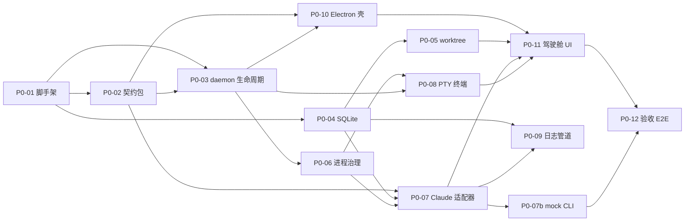

# Aether 任务清单（TASK_LIST）

> 依据：项目决策（2026-11-15 用户拍板）+ 复刻蓝图（调研 06，`docs/research/agentsroom/06-reimplementation-blueprint.md`）。
> 姊妹文档 PRD / ARCHITECTURE / SYSTEM_DESIGN / TECH_STACK 均已落盘；分期与接口口径已按裁定 G1-G15 统一，如仍有冲突以项目决策与 SYSTEM_DESIGN §2/§6.2 为权威。
> 规模图例：S ≤ 2 人日 · M = 3-5 人日 · L = 1-2 人周（单人粗估，仅供排期）。

## 1. 里程碑总览

| 阶段              | 主题             | 范围                                                                                                                                      | 里程碑验收                                                                                                                          | 来源             |
| ----------------- | ---------------- | ----------------------------------------------------------------------------------------------------------------------------------------- | ----------------------------------------------------------------------------------------------------------------------------------- | ---------------- |
| **P0 骨架**       | 跑通一条腿       | Electron 壳 + daemon 子进程 + SQLite + 类型化契约包 + Claude 单 agent（L1）+ 人类 shell PTY 终端 + worktree 生命周期                      | Windows 开发机全旅程：新建项目 → 创建任务并启动 agent → worktree → Claude 执行 → 活动可观察 → diff 展示 → 跟问一条消息 → 树杀无孤儿 | 蓝图 §7 改编     |
| **P1 核心四件套** | 审查闭环         | Codex 适配器（L2）、自定义 provider 注册（P1-11）、backlog 看板、diff 行内评论回传、commit、项目记忆、MCP host（backlog/terminal/memory） | 两 agent（Claude+Codex）并行 + 审查闭环 + agent 能读 backlog                                                                        | 蓝图 §7          |
| **P2 编排**       | agent 驱动 agent | 自定义 provider 内置 agent loop（L3-自定义；端点注册在 P1-11）、agent 邮箱、定时/webhook、quota 读取                                      | agent 经 mail/delegation 驱动另一个 agent 完成任务；自定义端点全程无代码完成一张票                                                  | 蓝图 §7 + 决策 2 |
| **P3 可靠性**     | 崩溃恢复         | 布局恢复、self-healing、headless 终端快照、进程治理强化                                                                                   | 崩溃恢复演示（kill 应用/daemon 后布局与会话恢复）                                                                                   | 蓝图 §7          |
| 扩展位（未排期）  | 广度             | ACP 标准协议 + 活体能力发现；TUI-in-PTY 广度层                                                                                            | —（决策：P2+ 扩展位，接口预留）                                                                                                     | 蓝图 §2/§5       |

**明确排除**（用户决策 3"不做账号和云端"）：账号体系（不做 Aether 自身账号体系；CLI 多开（HOME 目录隔离）为 P3 扩展位）、云端/远程 Fleet、E2EE relay、手机伴侣、Cloud Agents。蓝图 §7 的 P4 无限期搁置。

**与蓝图 §7 的分期差异**：P2 的"ACP+能力发现"按用户决策 2 改为"自定义 provider"（P1 端点注册 + P2 轻量内置 agent loop，Anthropic/OpenAI 兼容端点），ACP 与 TUI-in-PTY 移入扩展位；适配层三层分类法保留接口（L1 SDK / L2 专有协议 / L3 自定义）。

## 2. P0 骨架（细到可直接开工）

> P0 工期与人力假设：总量 ≈ 36-64 人日；2 人全职 ≈ 4-6 周，1 人全职 ≈ 7-9 周（规模图例为单人粗估，仅供排期）。

P0 任务依赖图：



### P0-01 Monorepo 脚手架与工程基线 — M ✅（2026-11-15 完成：本地验收全绿——test/typecheck/lint/E2E/spike；electron 45.3.2 锁定；CI 待仓库推送后首跑）

- 产出物：pnpm monorepo（目标结构：`apps/desktop`、`apps/daemon`、`packages/contracts`、`packages/core`（含共享工具，不设独立 shared 包）、`packages/adapters/{claude,codex,custom}`、`packages/terminal`、`packages/storage`、`packages/process-host`、`packages/mcp-host`（P1 建）；包按任务增量创建，最终形态见 SYSTEM_DESIGN §2）；`node:sqlite` spike（ELECTRON_RUN_AS_NODE 模式验证；唯一回退条件 = spike 失败改 better-sqlite3）；vitest + Playwright + typecheck/lint；CI（Windows+Linux 矩阵）；MIT LICENSE（作为 ADR 提出，见 §8）；README。
- 验收：`pnpm test / typecheck / lint` 全绿；CI 双平台冒烟通过；空 Electron 应用可启动。
- 依赖：无。TDD：先写一个恒真 vitest 用例 + Electron 启动冒烟用例，验证"红→绿"基线链路本身可用。

### P0-02 类型化契约包 `@aether/contracts` — M

- 产出物：RPC 方法类型（daemon↔渲染唯一边界）、领域命令/事件类型、`AgentStatus` 枚举与 zod schema 单一来源（T3 契约包模式，见调研 05.B）。
- 验收：渲染与 daemon 只 import contracts，无重复定义；schema 变更引起双向类型检查失败。
- 依赖：P0-01。TDD：先写 schema round-trip 测试（对象→parse→serialize→parse 等值）与非法事件被拒绝的反例测试。
- 备注：RPC 载体已定 JSON-RPC 2.0 over WebSocket（渲染直连 daemon 127.0.0.1，主进程仅 spawn/监护 daemon）。

```ts
// 契约包内状态机口径（T3 式，调研 05.B）
export type AgentStatus = "starting" | "ready" | "running" | "waiting" | "stopped" | "error";
```

### P0-03 daemon 子进程生命周期 — M

- 产出物：`apps/daemon` 独立进程（可无头运行）；Electron 主进程以 T3 DesktopBackendManager 式拉起（调研 05.B）：握手、心跳、健康检查、优雅退出、崩溃自动重启。
- 验收：SIGKILL daemon 后 Electron 3 秒内检测并重启、状态恢复查询正常；主进程无领域逻辑（CI 静态检查 import 边界）。
- 依赖：P0-01、P0-02。TDD：先写集成测试：spawn → 握手成功 → 心跳超时判定 → kill → 自动重启 → 再次握手。
- ⚠风险：Windows 子进程 stdio/管道行为差异（调研 06 §9.1 关联）。

### P0-04 SQLite 存储层与迁移链 — M

- 产出物：SQLite 单库（WAL）+ 迁移链框架；核心表照 VK 模型（调研 05.C），表名统一单数：`project / task / workspace / session / execution_process / execution_process_log`；首次运行种子：默认 claude-sdk `provider_config` + 默认 `agent_profile`。Orca 编排表（mailbox 等）到 P2 再加迁移。
- 验收：全新库自动迁移到最新；旧库逐级升级不丢数据；崩溃后 WAL 恢复。
- 依赖：P0-01。TDD：先写迁移测试（v0→vN 逐级 + 幂等）、repository CRUD 测试、双连接并发写测试。
- 备注：驱动已定 `node:sqlite`（P0-01 spike 已通过 2026-11-15：Electron 45.3.2 / 内置 Node 24.22.2，无回退）。

### P0-05 Git worktree 生命周期 — L

- 产出物：daemon 内 Git 服务：worktree 创建/删除/清理（根目录 = 项目同级 `.aether-worktrees/`，repo 外、不弄脏主 checkout；不可写时回退 `userData/aether/worktrees/<id>`）、分支命名、按路径全局锁（VK 做法，调研 05.C）、启动前准备（`.env` 拷贝；仅探测 npm/pnpm 并异步提示不阻塞——依赖安装治理移 P1-12）、孤儿清理（启动时 + 周期；workspace 状态引用 `@aether/contracts` 七值 `WorkspaceStatus`：reserved/creating/ready/archived/deleting/failed/orphaned，崩溃恢复扫描 creating/deleting/orphaned）。
- 验收：崩溃中途（已写库行未动 Git / 已动 Git 未回写）重启后能清理或补建，主 checkout 永远干净。
- 依赖：P0-04。TDD：先写"并发创建两个同名 workspace 只成功一个"集成测试（持久预留先行：先写库行再动 Git，调研 05.D.3）；再写崩溃恢复测试。

### P0-06 进程治理基础 — M

- 产出物：统一 spawn 服务：进程组分配、树杀（POSIX 进程组 / Windows Job 对象）、PID 级退出证明、Windows `.cmd` 引号与隐藏控制台窗口处理（Orca `@orca/process-host` 思路，调研 05.A + 蓝图 §2）。
- 验收：spawn 会产生孙进程的 fixture 程序，树杀后 Windows 与 POSIX 均无孤儿存活。
- 依赖：P0-03。TDD：先写树杀测试：三层进程 fixture → kill → 轮询 PID 全消失 + 拿到退出证明。
- ⚠风险：Windows 进程树击杀（调研 06 §9.1）。

### P0-07 Claude Agent SDK 适配器（L1）— L

- 产出物：`AgentAdapter` 接口（`spawn / spawnFollowUp / resume / cancel / dispose / normalizeLogs / discover / resolvePermission`，蓝图 §2，三层分类法在此定形；接口唯一权威 = SYSTEM_DESIGN §6.2，此处不复述）+ Claude 实现：`@anthropic-ai/claude-agent-sdk` query() stream-json、会话状态机（P0-02 枚举，事件直出不解析终端流，蓝图 §5）、`--resume` 续聊、spawn 钩子接入 P0-06。
- 验收：mock 事件流下状态迁移全覆盖；对真实 claude CLI 完成一个任务并落库；follow-up 以 `--resume` 接续同一会话。
- 依赖：P0-02、P0-04、P0-06。TDD：先写状态机纯函数单测（事件序列→状态迁移全路径含 error 分支）；再写 mock stream-json 适配器单测；真实 CLI 集成测试标记 CI 跳过。
- ⚠风险：CLI flag 兼容——flag 只信 CLI 自己的 `--help`、严格解析器拒绝重复 flag（调研 06 §2/§9）。

### P0-07b aether-mock-cli：scripted 回放引擎 — S~M

- 产出物：仓库根 `fixtures/aether-mock-cli`（非 workspace 包、不发布）script 化 mock CLI：读 fixture 脚本，按序回放 Claude stream-json 事件流与 Codex JSON-RPC 响应序列；协议覆盖随 P1-01 扩展 app-server 回放。
- 验收：mock CLI 驱动适配器与状态机跑完一个任务旅程（无真实 CLI、无网络）；同一套 fixture 供 P0-09/P0-12 复用。
- 依赖：P0-07；被 P0-12 依赖。TDD：先写"fixture 脚本 → 期望事件序列"回放断言测试，验证红→绿。

### P0-08 PTY 终端子系统 — L

- 产出物：daemon 内 PTY 池（node-pty，只服务人类 shell 终端 pane；TUI-in-PTY 为 P2+ 扩展位）+ 每 agent 一个活动 pane（agent 活动事件流，渲染见 P0-11）；有界滚动历史、resize、渲染端 xterm.js attach、Windows ConPTY 预热处理（蓝图 §3 MVP 行）。
- 验收：打开终端→键入→输出回传；resize 正确重绘；会话结束后 PTY 资源释放；Windows ConPTY 冒烟通过（含中文输出）。
- 依赖：P0-03、P0-06。TDD：先写 PTY 会话生命周期测试（create/write/read/resize/dispose 断言资源释放）与 UTF-8 编码测试。
- ⚠风险：Windows 终端全家桶——ConPTY 预热、`.cmd` 引号、隐藏控制台（调研 06 §9.1；AgentsRoom 40+ 版在修终端，见调研 README 公理 6）。

### P0-09 会话日志管道 — S

- 产出物：`execution_process_log` JSONL 原样落库 + 每 provider 一个 `normalizeLogs` 旁路转换器（VK 做法：原始先存、归一化可重放，调研 05.C）。
- 验收：同一份原始日志可重放归一化；vendor 格式变更只改一个转换器（用 fixture 演示）；日志写路径压测：万行/秒灌入不阻塞状态机事件与查询。
- 依赖：P0-04、P0-07。TDD：先写旁路转换器单测：fixture JSONL → 归一化事件序列。

### P0-10 Electron 壳与渲染骨架 — M

- 产出物：`apps/desktop`：窗口与布局框架（React）、走 contracts 的 RPC 客户端、主进程仅生命周期管理（零领域逻辑，T3 式，调研 05.B）。
- 验收：渲染全部数据经类型化通道获取；主进程 import 领域模块即 CI 失败。
- 依赖：P0-02、P0-03。TDD：先写 Playwright 冒烟：启动 app → 连接 daemon → 显示连接状态；再写 import 边界静态检查测试。

### P0-11 最小驾驶舱 UI — L

- 产出物：项目列表/新建、任务列表/新建（看板交互在 P1）、agent 卡片（状态点+耗时）、agent 活动视图（`session.<id>.events` 结构化事件流渲染：assistant 消息/工具调用 + 跟问输入框 + permission_request 批准弹层）、diff 视图（worktree 分支 vs 主分支，unified 单栏；并排高亮移 P1-03）、"启动 agent"（任务→worktree→Claude）。
- 验收：P0 里程碑全旅程仅靠 UI 完成（见 §1 P0 行）。
- 依赖：P0-05、P0-07、P0-08、P0-10。TDD：先写 Playwright E2E：新建项目→新建任务→启动 agent→观察到 running→结束后 diff 非空→跟问一条消息有响应。

### P0-12 P0 验收 E2E 与 Windows 冒烟 — S

- 产出物：全旅程验收脚本；Windows 专项冒烟清单（ConPTY、树杀、`.cmd`、含空格路径）；核心包覆盖率门禁 ≥80%（contracts/core/adapters/storage/process-host；desktop UI 不设线）。
- 验收：Windows 真机全旅程绿；`vitest --coverage` 达标。
- 依赖：P0-01~P0-11（含 P0-07b）。TDD：本卡即测试收口，先写旅程测试、按失败点回补。
- ⚠风险：Windows 终端问题须在真机复验，不可只信 CI（调研 06 §9.1）。

## 3. P1 核心四件套

| 编号  | 名称                              | 产出物                                                                                                                                                           | 验收标准                                                                          | 依赖              | 规模            |
| ----- | --------------------------------- | ---------------------------------------------------------------------------------------------------------------------------------------------------------------- | --------------------------------------------------------------------------------- | ----------------- | --------------- |
| P1-01 | Codex app-server 适配器（L2）     | JSON-RPC over stdio 客户端（自研，参考 T3 `effect-codex-app-server` 思路，调研 05.B）；复用 P0-06 治理与状态机                                                   | Codex 任务全旅程与 P0 Claude 同等水平；会话恢复能力差异在 UI 标注（调研 06 §9.2） | P0-06/07/09       | L ⚠flag 兼容    |
| P1-02 | backlog 看板                      | Kanban 列（todo/in_progress/in_review/done，VK status 枚举，调研 05.C）+ 拖卡到开发列即启动 agent + 每列 prompt 模板                                             | 拖卡→自动建 worktree+spawn；列间流转写库；刷新后状态一致                          | P0-11             | M               |
| P1-03 | diff 行内评论回传                 | 行内评论组装为 follow-up，经 `--resume` 发回原会话；并排高亮 diff 视图（自 P0 顺延）                                                                             | 评论后 agent 响应并修改，新 diff 反映评论                                         | P0-07、P1-02      | M ⚠会话恢复差异 |
| P1-04 | commit 流程                       | Changes 页一键 commit 到 worktree 分支（本地 commit 必做）；读 diff 生成 Conventional Commits 消息；可选 push/PR：经用户自己的 gh 凭证发起                       | commit 落地：分支/消息正确、主分支不受污染；push/PR 为可选增强                    | P1-02             | S               |
| P1-05 | 项目记忆                          | 本地 markdown 两根目录 `features/`+`global/`、wiki-link 互联（AgentsRoom 做法，调研 02 §c；纯本地，无服务端加密）；全 agent 共读                                 | 会话结束记忆文件留存，下一会话可读                                                | P0-04             | M               |
| P1-06 | MCP host 骨架                     | daemon 内 MCP host：127.0.0.1 HTTP + 每 console session token（蓝图 §6）；按 CLI 格式注入（Claude `.mcp.json`、Codex `CODEX_HOME`，调研 02 §d）                  | 外部 MCP client 可列工具；无 token 请求被拒                                       | P0-03/07、P1-01   | M               |
| P1-07 | MCP backlog 工具                  | 票 list/create/update/move；礼仪：读免确认、写需请求（蓝图 §6）                                                                                                  | agent 会话内改票状态，看板同步                                                    | P1-06             | S               |
| P1-08 | MCP terminal 工具                 | 跑命令/列 PTY/取退出码（`commands_list` 式，调研 02 §a）                                                                                                         | agent 经工具跑 `npm test` 并读到退出码                                            | P1-06、P0-08      | M               |
| P1-09 | MCP memory 工具                   | `memory_save`/读取，落到 P1-05 目录                                                                                                                              | agent 写的记忆进入项目记忆目录                                                    | P1-05/06          | S               |
| P1-10 | 多 agent 并行                     | 同项目多任务并行（各 worktree）+ agent 卡片状态总览                                                                                                              | Claude 与 Codex 两 agent 并行互不串扰（蓝图 §7 P1 验收）                          | P0-11、P1-01      | M               |
| P1-11 | 自定义 provider 注册（L3-自定义） | `provider_config` 注册：Anthropic 兼容 / OpenAI chatCompletions / OpenAI responses 三协议端点 + zod schema 校验 + discover 连通性/模型列表探测（G2 P1 分期口径） | 配置保存并通过连通性校验                                                          | P0-04、P0-07 接口 | M               |
| P1-12 | worktree 依赖安装治理             | worktree 就绪钩子：按 P0-05 探测到的包管理器（npm/pnpm）自动安装依赖；安装进度/失败在任务详情展示，不静默                                                        | 建任务后依赖自动就绪；安装失败可见、可重试                                        | P0-05、P1-02      | S               |

**P1 里程碑验收**（蓝图 §7）：两 agent 并行执行两任务 → 各自 diff 审查 + 行内评论回传修改 → 分别 commit；agent 经 MCP 读 backlog、跑命令、写项目记忆。

## 4. P2 编排

| 编号  | 名称                                         | 产出物                                                                                                                                                                 | 验收标准                                                                         | 依赖              | 规模                                            |
| ----- | -------------------------------------------- | ---------------------------------------------------------------------------------------------------------------------------------------------------------------------- | -------------------------------------------------------------------------------- | ----------------- | ----------------------------------------------- |
| P2-01 | 自定义 provider 内置 agent loop（L3-自定义） | 轻量内置 agent loop（agentLoop = builtin；happy-providers 三协议做法，调研 05.D）：驱动 P1-11 注册的三协议端点完成工具调用循环（用户决策 2；端点注册见 P1-11）         | 自定义端点全程无代码完成一张票（与 L1 同等旅程，走内置 loop，不依赖本地 CLI）    | P0-07 接口、P1-11 | L ⚠API 兼容性差异                               |
| P2-02 | agent 邮箱                                   | `mailbox` 表 + SQL 触发器派生投递状态（Orca 编排即数据，调研 05.A）；落盘投递、空闲间隙投递、read 语义、防循环限额、80% 强制 checkpoint（AgentsRoom 协议，调研 02 §h） | 离线投递不丢；状态链 Queued→Delivered→Read→Answered；限额触发拦截                | P0-04             | L                                               |
| P2-03 | MCP mail + delegation 工具                   | `agents_read_inbox`/发件 + delegation 临时子 agent + 配置文件声明多角色团队                                                                                            | agent A 委派 agent B 完成验证并回信（蓝图 §7 P2 验收）；多角色团队按配置文件拉起 | P2-02、P1-06      | M                                               |
| P2-04 | 定时任务                                     | 免 cron 表达式定时（每N分钟/每天多时刻）、错过补跑、历史可重开（调研 01 §01 Scheduled tasks）                                                                          | 错过窗口的排程启动后补跑一次                                                     | P0-03             | M                                               |
| P2-05 | webhook 触发（本地）                         | 本地 HTTP 端点（已定案仅监听 127.0.0.1）+ HMAC-SHA256 验签/过滤/限流，payload 成 prompt 变量（trigger 机制，调研 02 §i）；应用关闭时排队重放                           | 未签名请求 401；签名请求触发任务                                                 | P0-03             | S                                               |
| P2-06 | quota/token 用量读取                         | 直读 `~/.claude/projects/` JSONL 算 token（AgentsRoom 做法，调研 01 §03）；Codex 侧读其会话目录；进度条+阈值告警                                                       | 展示数值与 CLI 自报同数量级；过阈值桌面通知                                      | P0-09             | M ⚠配额不可预测（调研 06 §9.5：只监控不编公式） |

**扩展位（未排期，决策定 P2+）**：ACP 标准协议 + 活体能力发现（蓝图 §2 L3；VK 把新 agent 接入成本降到"填一条命令"，调研 05.C）；TUI-in-PTY 广度层（一个枚举接任意 CLI + 终端流解析三通道，蓝图 §5——per-provider 规则是 AgentsRoom 的隐性苦活）。P0-02/P0-07 的接口设计须为两者预留扩展点。

## 5. P3 可靠性

| 编号  | 名称               | 产出物                                                                                                                                      | 验收标准                                       | 依赖            | 规模                            |
| ----- | ------------------ | ------------------------------------------------------------------------------------------------------------------------------------------- | ---------------------------------------------- | --------------- | ------------------------------- |
| P3-01 | 布局恢复           | 布局快照 ≤15s 落盘（AgentsRoom，调研 02 §a）；重启后重 spawn + `--resume` 续聊                                                              | kill 应用重开后布局、终端、会话恢复            | P0-07/08、P1-01 | M ⚠会话恢复差异（调研 06 §9.2） |
| P3-02 | self-healing       | daemon 崩溃自动恢复、agent 卡死检测重启、断线重连事件重放（契约带 cursor）                                                                  | 崩溃恢复演示（蓝图 §7 P3 验收）                | P0-03、P3-01    | M                               |
| P3-03 | headless 终端快照  | daemon 内 `@xterm/headless` 权威仿真 + SerializeAddon 快照 → 客户端 attach 拿快照+增量；Chat↔Terminal 无损互切（Orca，调研 05.A + 蓝图 §3） | 重开窗口终端无闪烁全屏恢复；同一终端多视图一致 | P0-08           | L                               |
| P3-04 | 进程治理强化       | Process Guard 三条件判卡死（大+老+CPU 空闲，调研 01 §03）、PTY 后代回收、unproven-retirement 棘轮（Orca，调研 05.A）                        | 注入卡死进程 fixture 被识别并处置              | P0-06           | L ⚠Windows 进程树               |
| P3-05 | 打包分发（建议位） | electron-builder 全平台矩阵、更新 feed、代码签名                                                                                            | 三平台安装包可安装运行                         | P0-12           | M（优先级 TBD §8）              |

## 6. 风险任务标注汇总

| 风险                                                 | 涉及任务      | 出处          | 缓解                                                            |
| ---------------------------------------------------- | ------------- | ------------- | --------------------------------------------------------------- |
| Windows 终端（ConPTY 预热、`.cmd` 引号、隐藏控制台） | P0-06/08/12   | 调研 06 §9.1  | P0 即排真机冒烟；参考 Orca 处理（调研 05.A）                    |
| 进程树击杀                                           | P0-06、P3-04  | 调研 06 §9.1  | 进程组/Job 对象 + 退出证明；双平台树杀测试先行                  |
| CLI flag 兼容                                        | P0-07、P1-01  | 调研 06 §2/§9 | flag 只信 CLI `--help`；严格解析器拒重复 flag                   |
| 会话恢复仅部分 CLI 支持                              | P1-03、P3-01  | 调研 06 §9.2  | 仅 L1/L2 声明 resume；UI 标注差异，其余走"新会话+喂 transcript" |
| prompt 约束不可靠                                    | P2-01         | 调研 06 §9.3  | read-only 等约束落到 flag/工具缺失，不靠提示词                  |
| agent 改测试把红改绿                                 | 全部 TDD 任务 | 调研 06 §9.6  | check 以退出码为准；验收测试先于 agent 启动写好                 |
| 上游依赖死亡（VK 教训）                              | 依赖选型      | 调研 06 §9.4  | 只选 MIT/Apache-2.0 依赖；关键件准备接盘                        |
| 配额换算不可知                                       | P2-06         | 调研 06 §9.5  | 只监控不预测，不编公式                                          |

## 7. PRD 功能需求映射（临时口径）

> PRD 已落盘、编号稳定（P0-1…P3-4）；本表按蓝图 §7 分期 + 调研 01 功能清单口径建立映射，编号以 PRD 为准。

| 功能（调研 01 清单口径）                  | 阶段                               | 对应任务                            |
| ----------------------------------------- | ---------------------------------- | ----------------------------------- |
| 多项目多 agent 一窗口                     | P0→P1                              | P0-10、P0-11 → P1-10                |
| Git worktrees                             | P0                                 | P0-05                               |
| 每任务活动视图（事件流）                  | P0                                 | P0-08 + P0-11                       |
| 人类 shell 终端                           | P0                                 | P0-08                               |
| Agent status tracking                     | P0                                 | P0-07（状态机）+ P0-11（状态点 UI） |
| Vibe coding review（diff 审查）           | P0（unified 单栏）→ P1（并排高亮） | P0-11 → P1-03                       |
| 拖卡即启 agent（backlog 看板）            | P1                                 | P1-02                               |
| 行内评论回传 agent                        | P1                                 | P1-03                               |
| AI commit messages / Changes 页           | P1                                 | P1-04                               |
| Project memory                            | P1                                 | P1-05 + P1-09                       |
| AgentsRoom MCP（backlog/terminal/memory） | P1                                 | P1-06 ~ P1-09                       |
| Agent messaging                           | P2                                 | P2-02 + P2-03                       |
| Agent delegation                          | P2                                 | P2-03                               |
| Scheduled tasks                           | P2                                 | P2-04                               |
| Webhook triggers                          | P2                                 | P2-05                               |
| Token usage / Usage limit alerts          | P2                                 | P2-06                               |
| Multi-provider（自定义端点）              | P1 注册 / P2 loop                  | P1-11 → P2-01                       |
| Restore session / Split view 布局恢复     | P3                                 | P3-01                               |
| Process Guard                             | P3                                 | P3-04                               |
| Conversation view（读 CLI transcript）    | 未排期                             | 依赖 P3-03 后评估                   |
| 多角色团队（配置文件声明）                | P2                                 | P2-03                               |
| Compare agents / Fork 画布                | 未排期                             | backlog                             |
| 手机/relay/云/账号/远程                   | 排除                               | 用户决策 3                          |

## 8. 待定（TBD）汇总

> 已决回收（不再 TBD）：SQLite 驱动 = `node:sqlite`（P0-01 spike 验证，唯一回退条件 = spike 失败改 better-sqlite3）；daemon↔渲染 RPC 载体 = JSON-RPC 2.0 over WebSocket；webhook 监听范围 = 仅 127.0.0.1（P2-05）；P1 git 集成 = 本地 commit 必做 + 可选 push/PR 经用户自己的 gh 凭证（P1-04）；MCP P1 家族含 memory（P1-09）。

1. （已关闭）MIT 许可证已确认（2026-11-15，ADR-007 登记；LICENSE 落仓库根）。
2. ACP / TUI-in-PTY 分期与蓝图 06 §7 存在差异（决策定 P2+ 扩展位；蓝图将 ACP 排 P2、TUI 排 P3）——PRD/SYSTEM_DESIGN 落盘后统一口径。
3. 打包分发/自动更新/代码签名未在决策中列出（P3-05 为建议位，优先级待定）。
4. §7 PRD 映射编号对齐（已关闭：PRD 已落盘、编号稳定，§7 表以 PRD 编号为准）。
5. E2E 中真实 CLI 的测试策略边界（CI 无 claude/codex 时用 mock + 本地手动 smoke 的分界；P0-07b 落地后 mock 覆盖面扩大）。
