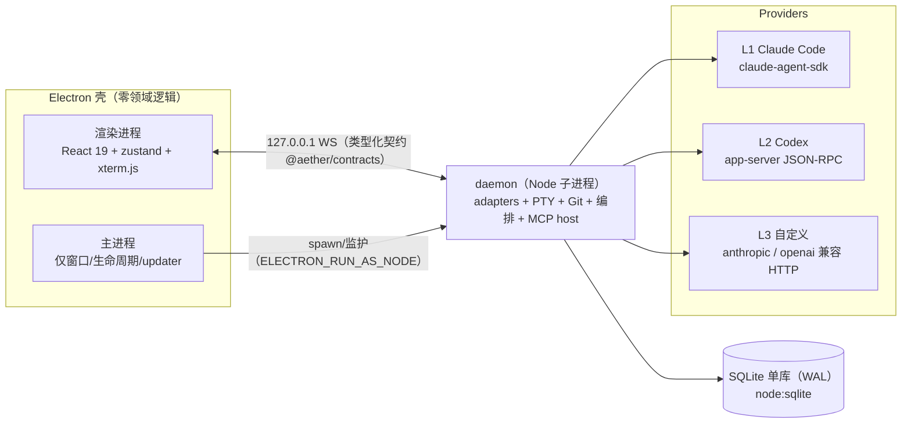

# Aether 技术栈

> 状态：Draft v0.1（2026-11-15） · 关联：[调研 README](research/agentsroom/README.md)（七条设计公理）、[06 复刻蓝图](research/agentsroom/06-reimplementation-blueprint.md)（架构骨架）
> 项目决策（已拍板）：Electron + TypeScript 桌面应用；daemon 分离（T3 式）；provider 支持 Claude Code 协议 + GPT 协议且自定义可注册；纯本地（无账号/云端/relay/手机端）；开源（**MIT**，ADR-007 已确认 2026-11-15）。
> 本文只回答"用什么、怎么构建、怎么测"；分层见 [ARCHITECTURE.md](ARCHITECTURE.md)，数据模型与目录结构见 [SYSTEM_DESIGN.md](SYSTEM_DESIGN.md)。

## 0. 选型原则与总览

三条原则：

1. **只选头部项目生产验证过的组合**：React 19 / zustand / xterm.js / node-pty / node:sqlite 全部是 Orca（124.8k★）与 T3（60.2k★）在 2026 年的生产栈（见调研 05.A/05.B）。
2. **纯本地、零云端依赖**：依赖清单里不出现任何账号、relay、遥测类包（项目决策）。
3. **单一 TS 生态 + 最少原生模块**：node-pty 是唯一必须的原生模块；SQLite 用 Node 内置的 `node:sqlite`，避免 Electron 升级时的 ABI 重建之痛（见 §1.4）。



## 1. 依赖清单

### 1.1 运行时依赖

| 依赖                             | 用途（一句话）                                                                                                   | 出处/依据                                                             |
| -------------------------------- | ---------------------------------------------------------------------------------------------------------------- | --------------------------------------------------------------------- |
| `electron`                       | 桌面壳与内置 Node 运行时；主进程零领域逻辑，仅做窗口/生命周期/updater                                            | 项目决策；daemon 分离公理（调研 README 公理 2）                       |
| `react` / `react-dom` 19.x       | 渲染进程 UI 框架，无业务逻辑                                                                                     | Orca 生产用 React 19.2（见调研 05.A）                                 |
| `zustand`                        | 渲染层本地 UI 状态（领域状态由 daemon 经契约推送）                                                               | Orca 同款（见调研 05.A）                                              |
| `@xterm/xterm` 6.x + addons      | 人类 shell 终端 pane 渲染（agent 活动走事件流视图，不用 xterm）；addons 按需引入（serialize 为 P3 快照路径预留） | Orca 用 6.1.0-beta + 9 addon（见调研 04①/05.A）；MVP 方案见调研 06 §3 |
| `node-pty` 1.1                   | PTY 创建，只跑在 daemon 内（仅人类交互 shell；TUI-in-PTY 为 P2+ 扩展位）                                         | Orca 同版本（见调研 04①）；终端归属 daemon 见调研 06 §3               |
| `@anthropic-ai/claude-agent-sdk` | L1 接入：spawn Claude Code、stream-json 结构化事件、会话谱系/resume                                              | 调研 06 §2/§8；Orca/T3/Happy 三家同款（见调研 05）                    |
| （无包）Codex app-server         | L2 接入：自研轻量 JSON-RPC over stdio 客户端，直接 spawn `codex` CLI（见 §1.5）                                  | T3 自研 effect-codex-app-server、VK codex 适配器（见调研 05.B/05.C）  |
| （内置）`node:sqlite`            | SQLite 单库唯一事实源，WAL 模式 + prepared statements                                                            | Orca/T3 生产先例（见调研 05.A/05.B）；对比见 §1.4                     |
| `zod`                            | 全部边界校验：契约消息、provider 协议消息、自定义 provider 配置、外部输入                                        | Orca ACP 用 zod 校验（见调研 05.A）；全局输入校验规则                 |
| （系统）`git`                    | worktree 生命周期、checkpoint、diff——daemon 直接调用系统 git CLI，不引入 git 库                                  | 调研 06 §4（worktree 是一等实体）；VK/T3 均直接用 git                 |
| `electron-updater`               | 自动更新，feed 指向 GitHub Releases（见 §2.3）                                                                   | AgentsRoom 同款 latest-mac.yml feed（见调研 02.i）                    |
| `radix-ui` + `tailwindcss` 4     | 无头组件库 + 样式（UI 基建，可换）                                                                               | Orca 同款组合（见调研 04①）                                           |
| `@modelcontextprotocol/sdk`      | P1 起 MCP host 的服务端实现（backlog/terminal/memory 工具家族）                                                  | 调研 06 §6；electron-mcp-server 同款依赖（见调研 02.i）               |

### 1.2 开发时依赖

| 依赖                             | 用途（一句话）                                            | 出处/依据                                                           |
| -------------------------------- | --------------------------------------------------------- | ------------------------------------------------------------------- |
| `typescript`（strict）           | 全仓类型底座，契约包是渲染/daemon 的单一类型来源          | T3 packages/contracts 模式（见调研 06 §8）                          |
| `electron-vite`                  | desktop 三段构建（main/preload/renderer）与开发热载       | Electron + Vite 社区标准工具链                                      |
| `tsup`                           | daemon 与契约包的独立 bundle（daemon 作为资源打包进应用） | daemon 必须能脱离 desktop 独立构建（调研 README 公理 2）            |
| `electron-builder`               | 出包目标矩阵 + 各平台安装器（见 §2.1）                    | AgentsRoom 同款（dmg/exe/AppImage/deb 全矩阵，见调研 02.i）         |
| `vitest` + `@vitest/coverage-v8` | 单元/集成测试与覆盖率测量                                 | 全局测试规则（TDD，80%）                                            |
| `@playwright/test`               | E2E（`_electron` API 直接拉起应用）                       | 调研 06 §7 验收流；Orca 内嵌 playwright-core 做浏览器（见调研 04①） |
| `oxlint` + `oxfmt`               | Lint 与格式化 + 架构边界 ratchet（见 §1.7 决策）          | Orca 用 oxlint ratchet 把架构决策变成硬约束（见调研 05.A）          |
| `pnpm`                           | workspace 包管理与任务编排（见 §3.3）                     | Orca/T3 均为 pnpm monorepo（见调研 04①/②）                          |

### 1.3 决策 D1：Electron 版本策略

- **不锁死具体大版本，跟随最新 stable**：调研快照（2026-11）显示 Orca 在 Electron 43、T3 在 Electron 44（见调研 05.A/05.B）——这是"当前生态水位"的参考线，P0 初始化时以 npm 上最新 stable 为准。**P0-01 已锁定 electron 45.3.2（2026-11-15，内置 Node 24.22.2）**。
- **锁定精确版本**（package.json 不用 `^` 范围跨大版本），每次升级是独立 PR + 全量测试矩阵。
- **升级节奏**：跟随 stable 跟进（Electron 大版本约 8 周一个，官方只维护最近三个）；不追 beta。
- 硬约束：所选版本必须内置可用 `node:sqlite`（Node ≥ 22.5 能力，Electron 43 已被 Orca 生产验证，见调研 05.A）——P0-01 完成 spike 验证（唯一回退条件见 §1.4）。

### 1.4 决策 D2：`better-sqlite3` vs `node:sqlite`（选 node:sqlite）

| 维度     | `better-sqlite3`                                                     | `node:sqlite`（选定）                                                                    |
| -------- | -------------------------------------------------------------------- | ---------------------------------------------------------------------------------------- |
| 原生模块 | 需要针对 Electron ABI 预编译/rebuild，每次 Electron 升级是打包风险点 | **内置，零 rebuild**；node-pty 已是唯一原生模块，不再加一个                              |
| 生产先例 | 广泛                                                                 | Orca（v2→v46 迁移链）与 T3（114 个 migration、WAL 128MiB）双头部背书（见调研 05.A/05.B） |
| API      | 更丰富（backup、自定义函数等）                                       | 覆盖 prepared statements/WAL/事务，MVP 所需全够                                          |
| 维护     | 单人维护的上游风险（VK 停运教训：选依赖要准备接盘，见调研 06 §9.4）  | 随 Node 官方长期维护                                                                     |

结论：**`node:sqlite`**。用 prepared statements + WAL；迁移链自研（手写顺序 migration，参考 Orca/T3 做法，见调研 05.A/05.B）。P0-01 spike 已通过（2026-11-15：Electron 45.3.2 / 内置 Node 24.22.2，`pnpm spike:node-sqlite`；内存 CRUD / 文件 WAL / prepared statements / 重开持久化全项可用）——回退条件未触发，`better-sqlite3` 备选关闭。

### 1.5 决策 D3：Codex（GPT 协议）接入方式

Codex 没有 npm SDK 可用，接入方式为**自研轻量 JSON-RPC over stdio 客户端**：

- daemon 内 `child_process.spawn('codex', ['app-server'], { windowsHide: true })`，stdin/stdout 上跑 JSON-RPC，入站消息全部过 zod 校验；
- 协议映射参考两份 MIT/Apache 源码（不直接依赖）：T3 的 `effect-codex-app-server`（Effect 太重，抄协议不抄框架，见调研 05.B）、VK 的 codex stdio 适配器（Rust 逻辑可移植，Apache-2.0，见调研 05.C）；
- 进程治理三件事必须做（见调研 06 §2 关键细节）：进程组杀树、Windows 隐藏控制台窗口、flag 只信 CLI 自己的 `--help` 输出。

### 1.6 决策 D4：自定义 Provider（用户拍板的扩展位）

三层分类法保留接口（SDK / 专有协议 / 自定义），自定义 provider 走 **HTTP 兼容端点 + 轻量内置 agent loop**（daemon 内最小 tool-loop：system prompt + 工具集 + max-turns），协议三选一（参考 happy-providers 的 anthropic/chatCompletions/responses 三协议做法，见调研 05.D；组合方式为项目决策）：

```ts
// packages/contracts/src/provider.ts（示意，最终形状见 SYSTEM_DESIGN §6.2/§6.3）
interface CustomProviderConfig {
  kind: "custom";
  protocol: "anthropic" | "openai-chat" | "openai-responses";
  baseUrl: string; // 任意兼容端点
  model: string;
  apiKeyEnv: string; // 只存环境变量名，不存值（见 §5）
  headers?: Record<string, string>;
}
```

- HTTP 客户端用标准 `fetch`/`undici`，**不引入重量级官方 SDK**（TBD：若 anthropic/openai 官方 SDK 的流式解析明显省工再评估，见 §7）；
- 自定义 provider 分期已定：P1 注册+校验+探测 / P2 内置 agent loop（见 §7）。

### 1.7 决策 D5：ESLint+Prettier vs oxlint+oxfmt（选 oxlint+oxfmt）

| 维度         | ESLint + Prettier                   | oxlint + oxfmt（选定）                                                                                              |
| ------------ | ----------------------------------- | ------------------------------------------------------------------------------------------------------------------- |
| 速度         | 慢（TS 类型感知规则尤甚）           | Rust 实现，快一个数量级，适合全仓 ratchet 每次提交都跑                                                              |
| 架构约束先例 | 生态规则最全                        | **Orca 用几十个 oxlint ratchet 把架构决策变成硬约束**（如"渲染层只准写 id"，见调研 05.A）——这正是本项目最需要的能力 |
| 规则覆盖     | 最广（import 边界、deprecation 等） | 主流规则够用；缺口用 ratchet 脚本补                                                                                 |
| 格式化       | Prettier 事实标准                   | oxfmt 较新，风格选项少                                                                                              |

结论：**oxlint + oxfmt**。P0 验证两点：import 边界规则是否够用、oxfmt 与现有编辑器工作流兼容；若有硬缺口回退 ESLint（决策记录进 ADR）。核心 ratchet 第一批：渲染进程禁止 import daemon 内部模块（只准 `@aether/contracts`）、SQL 必须走 prepared statement、禁 `db.exec` 拼接。

## 2. 构建与打包

### 2.1 electron-builder 目标矩阵

| 平台    | 目标               | 架构       | 备注                                                          |
| ------- | ------------------ | ---------- | ------------------------------------------------------------- |
| macOS   | `dmg` + `zip`      | arm64、x64 | zip 供 updater；AgentsRoom 同款 dmg/zip 双产物（见调研 02.i） |
| Windows | `nsis`             | x64、arm64 | nsis 供 updater（latest.yml）；winget 分发 TBD                |
| Linux   | `AppImage` + `deb` | x64        | AppImage 供 updater；deb 覆盖 Debian/Ubuntu                   |

### 2.2 daemon 的打包方式

- daemon 由主进程用 `process.execPath` + `ELECTRON_RUN_AS_NODE=1` 拉起（同一二进制内嵌 Node，**不单独分发 Node 运行时**）；T3 的 DesktopBackendManager 证明"桌面把 server 当子进程拉起"是最干净模式（见调研 05.B/调研 06 §1）。
- daemon 由 tsup bundle 成单文件，经 electron-builder `extraResources` 打进应用；`node:sqlite` 内置于该运行时（P0-01 spike 验证 `ELECTRON_RUN_AS_NODE` 可用，唯一回退条件见 §1.4）。
- P0 验收即含"杀渲染进程重开，agent 会话仍在"（kill-on-close：daemon 随主进程结束；渲染层崩溃无感存活，主进程重启后 daemon 自动重启并从 SQLite 恢复会话续聊；调研 06 §7 P0 骨架验收）。

### 2.3 自动更新

- `electron-updater` 的 **generic provider 指向 GitHub Releases**：开源项目免费、无自建服务器，符合纯本地决策（更新元数据 `latest.yml`/`latest-mac.yml`/`latest-linux.yml` 随 Release 发布；AgentsRoom 即此方案，见调研 02.i）。
- 签名未启用前，macOS updater 会被 Gatekeeper 拦（见 §2.4 的先后依赖）。
- TBD：GitHub Releases 在中国大陆的可达性差时是否提供镜像 feed（见 §7）。

### 2.4 代码签名与公证（TODO）

| 平台    | 状态       | 待办                                                                                                        |
| ------- | ---------- | ----------------------------------------------------------------------------------------------------------- |
| macOS   | TODO       | Apple Developer 账号（付费）→ Developer ID 签名 + 公证（AgentsRoom 先例，见调研 02.i）；公证前 updater 受限 |
| Windows | TODO       | EV 证书（贵）vs 先 unsigned（SmartScreen 警告）——待拍板                                                     |
| Linux   | 无签名惯例 | AppImage/deb 不处理                                                                                         |

MVP 阶段可先出未签名包供早期用户与 CI 使用，签名账号到位后启用（顺序：先 macOS 公证，Windows 视成本）。

## 3. 开发工具链

### 3.1 TypeScript（strict 全开）

- `strict: true` 基线之上追加：`noUncheckedIndexedAccess`、`exactOptionalPropertyTypes`、`noImplicitOverride`、`verbatimModuleSyntax`；`moduleResolution: bundler`。
- 三份 tsconfig：`tsconfig.base.json`（共享）、daemon/adapters 按 Node 规则、desktop 渲染层按 DOM 规则；契约包类型双端复用（T3 packages/contracts 单一来源模式，见调研 06 §8）。

### 3.2 Lint / Format

oxlint + oxfmt（§1.7 决策）。CI 里 lint 失败即挡 PR；架构 ratchet 只增不减（Orca 的"棘轮"做法——存量违规进豁免清单，只许减不许加，见调研 05.A）。

### 3.3 pnpm workspace

```
apps/
  desktop/        # Electron 壳：main / preload / renderer（electron-vite）
  daemon/         # Node 守护进程：全部领域逻辑（tsup bundle）
packages/
  contracts/      # 类型化契约 + zod schema（渲染与 daemon 的唯一边界）
  core/           # 领域核心 + 共享纯工具（零依赖；不设独立 shared 包）
  adapters/       # provider 适配层（可独立测试）
    claude/       #   L1 Claude Code（claude-agent-sdk）
    codex/        #   L2 Codex（app-server JSON-RPC 客户端）
    custom/       #   L3 自定义 provider（HTTP 兼容端点）
  terminal/       # 终端域：PTY 会话与终端 pane 支撑
  storage/        # 存储层：node:sqlite + 迁移链 + 日志写路径
  process-host/   # 子进程托管：spawn/监护/进程组杀树
  mcp-host/       # MCP host 服务端（P1 建：backlog/terminal/memory 工具家族）
fixtures/
  aether-mock-cli/  # scripted 回放 mock CLI（非 workspace 包、不发布，仅供测试）
```

常用脚本：

| 命令                           | 作用                                                         |
| ------------------------------ | ------------------------------------------------------------ |
| `pnpm dev`                     | 并行起 daemon 与 desktop（electron-vite 热载）               |
| `pnpm lint` / `pnpm typecheck` | oxlint+oxfmt / tsc --noEmit（全仓）                          |
| `pnpm test`                    | vitest 单元 + 集成（本地含真实 CLI smoke）                   |
| `pnpm test:e2e`                | Playwright Electron                                          |
| `pnpm dist`                    | electron-builder 全矩阵出包                                  |
| `pnpm release`                 | tag 触发的发版流水线（构建→签名→GitHub Release→latest*.yml） |

## 4. 测试策略（TDD，80% 门槛）

### 4.1 分层

| 层           | 工具                                    | 范围                                                                                                                                                                          | 环境要求                               |
| ------------ | --------------------------------------- | ----------------------------------------------------------------------------------------------------------------------------------------------------------------------------- | -------------------------------------- |
| 单元（主力） | vitest                                  | 契约（zod schema 往返/兼容性）、适配层协议解析（录制 fixture JSONL 回放，不碰真实 CLI）、daemon 领域逻辑（状态机纯函数、worktree 生命周期用临时目录真实 git、mailbox 触发器） | 无                                     |
| 渲染组件     | vitest + @testing-library/react + jsdom | 组件与 store 投影（渲染层薄，占比小）                                                                                                                                         | 无                                     |
| 集成         | vitest（`@integration` 标记）           | adapter 对真实 `claude`/`codex` CLI 的 smoke：PATH 检测→spawn→一轮对话→resume                                                                                                 | 本机登录态或 API key；CI 可选（见 §6） |
| E2E          | Playwright `_electron`                  | 关键用户流，见 §4.2；agent 用 **aether-mock-cli**（按协议回放脚本化响应的假 CLI）保证 hermetic                                                                                | 无外部依赖                             |

- **aether-mock-cli** 落位仓库根 `fixtures/aether-mock-cli`（非 pnpm workspace 包、不发布，仅供测试；见 §3.3 结构树）：scripted 回放引擎，读 fixture 脚本驱动 stream-json 与 Codex JSON-RPC 响应序列；协议覆盖随 P1-01 扩展 Codex app-server 回放。

### 4.2 E2E 关键用例

- **P0**：① 首启→创建项目→CLI 检测；② 拖票→worktree 创建→agent 执行→活动可观察输出（事件流视图）；③ diff 展示 + 跟问一条消息；④ 杀渲染进程重开后 agent 会话仍在（kill-on-close 口径，对应调研 06 §7 P0 验收）。
- **P1**：⑤ 两 agent 并行于两个 worktree；⑥ diff 行内评论回传 agent；⑦ agent 经 MCP host 读 backlog；⑧ commit 创建。

### 4.3 覆盖率与流程

- 测量：`vitest --coverage`（v8 provider）；门槛 **lines/branches/functions/statements ≥ 80%**（限核心包 contracts/core/adapters/storage/process-host，desktop UI 不设线），CI 强制，未达挡 PR。
- 排除：生成代码、`index.ts` barrel、e2e 目录、类型声明文件。
- TDD 纪律（全局规则）：新功能/修 bug 先写测试（RED→GREEN→REFACTOR）。
- 特有教训（调研 06 §9.6）：**agent 自己会把红测试改绿**——验收 check 必须以退出码为准且先于 agent 启动写好；CI 上 lint→typecheck→test 的顺序与门禁不可被运行时绕过。

## 5. 安全清单（对照全局 security 规则）

| 规则            | Aether 落地措施                                                                                                                                                                                   | 出处                                                                         |
| --------------- | ------------------------------------------------------------------------------------------------------------------------------------------------------------------------------------------------- | ---------------------------------------------------------------------------- |
| 无硬编码 secret | CI 明文扫描 + oxlint 禁 token 模式字面量；所有 key 只经环境变量/配置注入                                                                                                                          | 全局规则；Happy 凭证 env 注入先例（见调研 05.D）                             |
| secret 存储     | OS keychain 存储 + SQLite 只存 SecretRef 引用（密文也不入库）；主进程 `safeStorage` 解密后于 daemon 握手时经环境变量一次性下发（daemon 内存持有）；MCP session token 用 `crypto.randomBytes` 生成 | 全局规则；AgentsRoom token 本地文件先例（见调研 02.c）                       |
| 本地服务边界    | MCP host 只绑 `127.0.0.1` + 每 console 独立 token，不出现 `0.0.0.0`                                                                                                                               | 调研 02.d（AgentsRoom 同款）；Cloudroom 亦"仅 localhost+token"（见调研 04⑪） |
| SQL 注入        | 一律 prepared statements；oxlint ratchet 禁 `db.exec` 字符串拼接                                                                                                                                  | 全局规则                                                                     |
| 输入校验        | zod 在四类边界全量 parse：IPC/daemon API、provider 协议消息、自定义 provider 配置、MCP 请求                                                                                                       | 全局规则；Orca ACP zod 先例（见调研 05.A）                                   |
| XSS             | React 默认转义；xterm 输出走 API 写入不拼 HTML；diff 渲染全组件化                                                                                                                                 | 全局规则                                                                     |
| 错误不泄漏      | daemon 错误码化 + 用户可读消息；日志对 token/绝对路径脱敏；渲染层不显示内部堆栈                                                                                                                   | 全局规则                                                                     |
| 无账号/云端     | 不引入任何认证/relay/遥测 SDK；进程间信任 = 本地 token                                                                                                                                            | 项目决策（纯本地）                                                           |

## 6. CI 建议（GitHub Actions）

| Workflow      | 触发                     | 运行环境                                       | 内容                                                                                                                                        |
| ------------- | ------------------------ | ---------------------------------------------- | ------------------------------------------------------------------------------------------------------------------------------------------- |
| `ci`          | PR / push                | ubuntu-latest + **windows-latest**             | lint（oxlint+oxfmt）→ typecheck → unit test + 覆盖率门槛（80%）。Windows 必跑：node-pty/ConPTY 与进程树行为是已知最大坑源（见调研 06 §9.1） |
| `e2e`         | PR（可夜间全量）         | macos / windows / ubuntu                       | `pnpm test:e2e`（hermetic，mock CLI）                                                                                                       |
| `integration` | `workflow_dispatch` 手动 | ubuntu-latest                                  | 真实 CLI smoke；secrets 注入测试 key（策略 TBD，见 §7）                                                                                     |
| `release`     | tag `v*`                 | macos(arm64/x64) + windows(x64/arm64) + ubuntu | `pnpm dist` 全矩阵 → 签名/公证（就绪后）→ 上传 GitHub Release（含 latest*.yml）→ 触发 electron-updater                                      |

- 覆盖率报告以 artifact 上传；PR 评论覆盖率变化。
- 原生依赖（node-pty）在 Windows runner 需 VS Build Tools——GitHub 托管 runner 自带；若编译时间成为问题再缓存。

## 7. 待定项汇总（TBD）

1. ~~Electron 精确版本锁定~~（已关闭）：P0-01 锁定 electron 45.3.2（内置 Node 24.22.2）；spike 已通过，`node:sqlite` 定案无回退（见 §1.3/§1.4）。
2. **xterm.js 6 stable vs beta**：Orca 在用 6.1.0-beta（见调研 04①）；若选型时 6 stable 已发布则直接用，否则锁 beta 并评估回退 5.5（VK 生产版本，见调研 05.C）。
3. **代码签名/公证**：macOS 需 Apple Developer 账号、Windows 需决定 EV 证书 or 先 unsigned（见 §2.4）。
4. **自定义 provider 分期（已裁定）**：P1 注册+校验+探测（provider_config 注册、zod 校验、discover 连通性/模型列表探测）/ P2 内置 agent loop；接口 P0 就定（contracts 里占位）。
5. **自定义 provider 的 HTTP 实现**：手写 fetch vs 官方 SDK（anthropic/openai）流式解析成本对比后定（见 §1.6）。
6. **Codex app-server 协议稳定性**：上游 CLI 迭代快，JSON-RPC 方法面可能变化——适配层做能力探测 + 版本记录，参考 VK"活体能力发现"（见调研 05.C）。
7. **集成测试 CI 凭证策略**：付费 secrets 注入 vs 仅维护者本地跑（见 §6）。
8. **更新 feed 的中国大陆可达性**：GitHub Releases 直连 or 镜像方案（见 §2.3）。
9. **UI 基建**：radix-ui + Tailwind 4 为建议（Orca 同款），是否引入组件生成器（shadcn 风格）待 UI 设计阶段定。
